# QuestBoard の つかいかた（こども よう）

> 「」の なかは、がめんに でる ことば です。がめんと おなじ もじで かいて あります。

---

## もくじ

1. [ログイン する](#1-ログイン-する)
2. [がめんの した の ボタン](#2-がめんの-した-の-ボタン)
3. [クエストを ほうこく する](#3-クエストを-ほうこく-する)
4. [スキップを たのむ](#4-スキップを-たのむ)
5. [さしもどされた とき](#5-さしもどされた-とき)
6. [じぶんで タスクを ふやす](#6-じぶんで-タスクを-ふやす)
7. [チェックイン と れんぞく きろく](#7-チェックイン-と-れんぞく-きろく)
8. [モンスターを そだてる（しんか・てんせい）](#8-モンスターを-そだてる)
9. [たからばこ と ごほうび](#9-たからばこ-と-ごほうび)
10. [コレクション（ずかん・アイテム・じっせき）](#10-コレクション)
11. [ひろば](#11-ひろば)
12. [こまった とき](#12-こまった-とき)

---

## 1. ログイン する

1. おうちの 人に 「ログインコード」を もらおう。
2. 「ようこそ、冒険者よ！」の がめんで、コードを 入れよう。
3. 「⚔ ログイン」を おそう。

- コードは **10分だけ**、**1回だけ** つかえるよ。
- 「コードが正しくありません」と でたら、おうちの 人に あたらしい コードを もらおう。

▼ さいしょの がめん

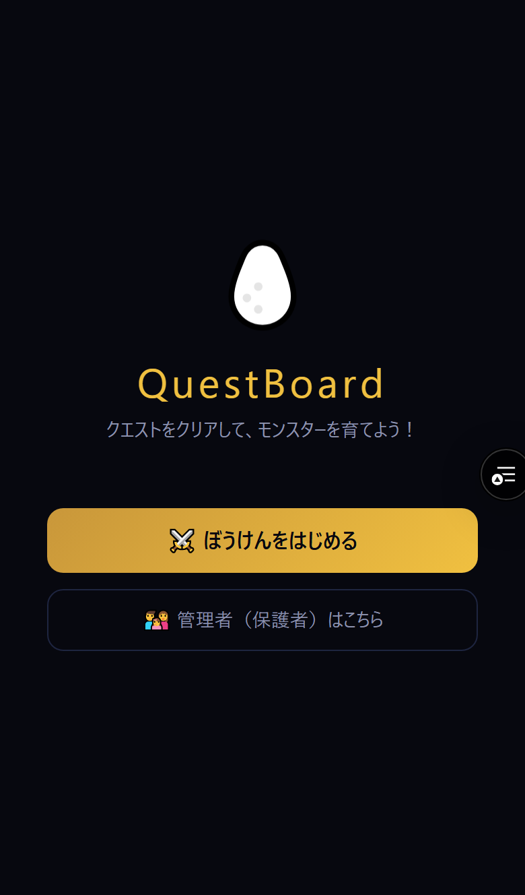

▼ ログインコードを いれた ところ

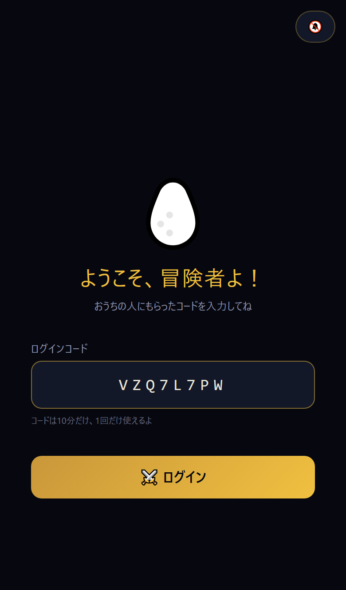

### ログアウト する とき
「🐣 育成」の がめんの いちばん したに 「🚪 ログアウト」が あるよ。
おすと 「本当にログアウトする？」と きかれるよ。
ログアウト すると、つぎは また コードが いるよ。

---

## 2. がめんの した の ボタン

| ボタン | なにが できる？ |
|---|---|
| ⚔️ クエスト | きょうの クエストを みる・ほうこく する |
| 🐣 育成 | じぶんの モンスターを みる |
| 📦 宝箱 | たからばこを あける・ごほうびを つかう |
| 🏕️ ひろば | なかまと あつまる・エールを おくる |
| 🏆 コレクション | ずかん・アイテム・じっせきを みる |

ボタンに しるしが ついて いたら、あたらしい ことが あるよ。

▼ クエストの がめん

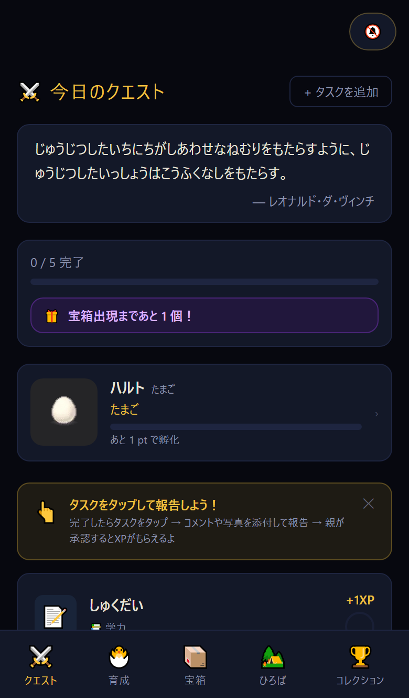

---

## 3. クエストを ほうこく する

「⚔ 今日のクエスト」に、きょう やる ことが ならんで いるよ。

1. おわった クエストを **タップ** しよう。
2. 「⚔ クエスト完了！」を おそう。
3. 「親の確認でポイント確定」と でたら ほうこく できたよ。

- おうちの 人が 「OK」 したら ポイント（pt）が もらえるよ。
- ほうこく した あとは 「確認中...」、OK が でたら 「承認済み」に なるよ。

▼ クエストを おした ところ

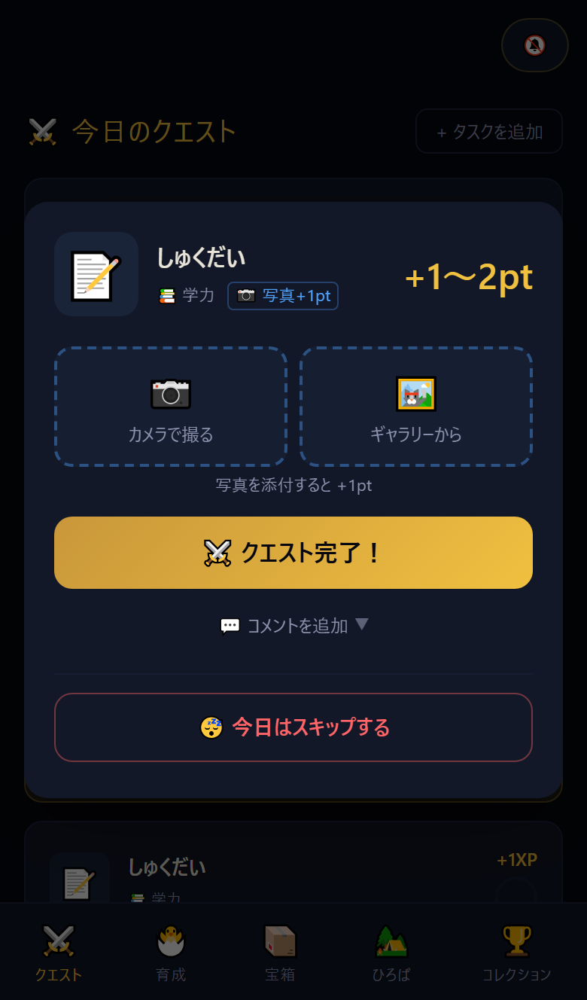

### コメントを つける
「💬 コメントを追加」を おすと、ひとこと かけるよ。かかなくても だいじょうぶ。

### しゃしんを つける
「📷 写真+1pt」と かいて ある クエストは、しゃしんを つけると **+1pt** もらえるよ。

1. 「📷 カメラで撮る」か 「🖼 ギャラリーから」を おす。
2. しゃしんが でたら 「⚔ クエスト完了！」を おす。

- しゃしんを えらびなおす ときは、しゃしんを タップ しよう。

### もっと ポイントを もらう ほうほう
- **じかんまでに ほうこく**: 「〇〇までに報告すると +1XP ボーナス！」と でて いたら、その じかんまでに ほうこく しよう。
- **「今日やる」を おす**: クエストの したの 「今日やる（完了で +1）」を おしてから クエストを おわらせると、ボーナスが もらえるよ。おすと 「✓ 宣言済み」に なるよ。

クエストの みぎうえの すうじ（たとえば 「+1〜3pt」）が、もらえる ポイントの めやす だよ。

▼ ほうこく した あと（確認中）

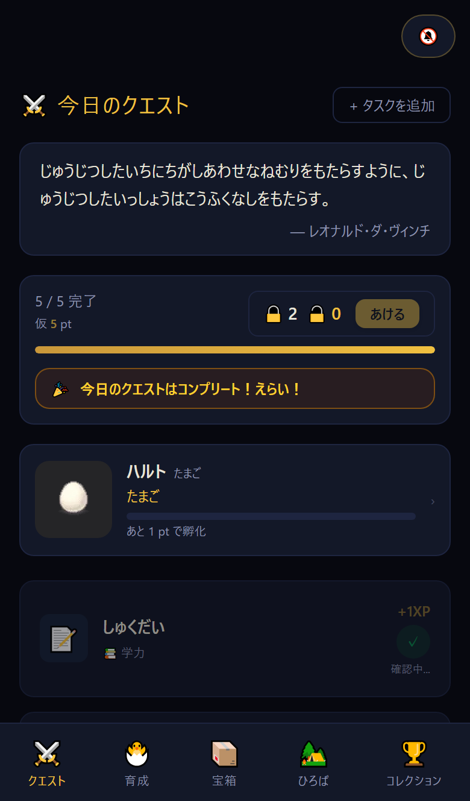

---

## 4. スキップを たのむ

きょうは できない ときは、スキップを おうちの 人に たのめるよ。

1. クエストを タップ する。
2. いちばん したの 「😴 今日はスキップする」を おす。
3. りゆうを えらぶか、じぶんで かく。
   - ⏰ 時間がなかった
   - 🙅 今日はできなかった
   - 😴 つかれた
   - 😅 わすれちゃった
   - 🤒 たいちょうがわるい
4. 「😴 スキップを申請する」を おす。

- 「スキップを申請したよ」と でたら できたよ。
- おうちの 人が OK すると 「スキップ」に なるよ。だめ だったら、もとの クエストに もどるよ。
- やめる ときは 「戻る」を おそう。

▼ スキップの りゆうを えらぶ ところ

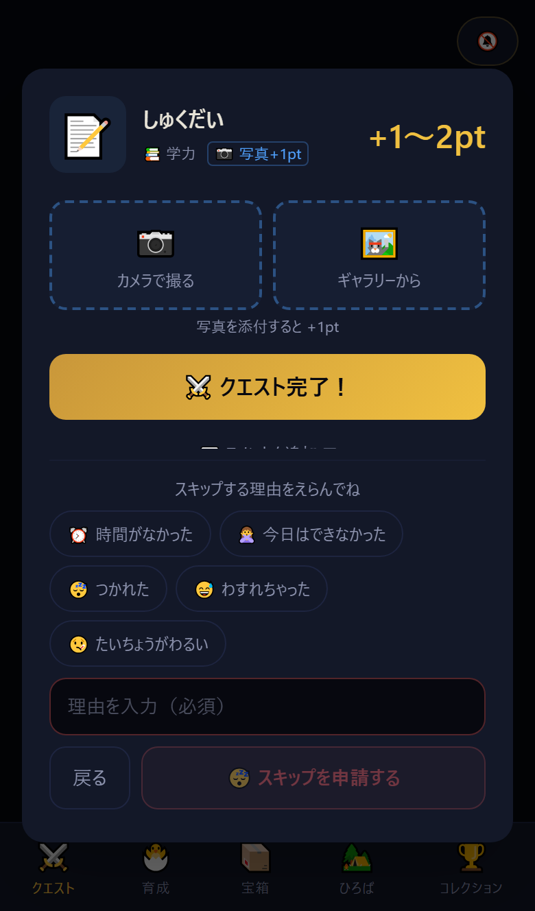

---

## 5. さしもどされた とき

おうちの 人が 「もう いちど やってね」と した クエストは、「差し戻し」に なるよ。

- クエストの したに 「差し戻し理由」が でるよ。よんで みよう。
- やりなおしたら、クエストを タップ して もう いちど ほうこく しよう。
- できない ときは、スキップを たのむ ことも できるよ。

▼ さしもどされた クエスト

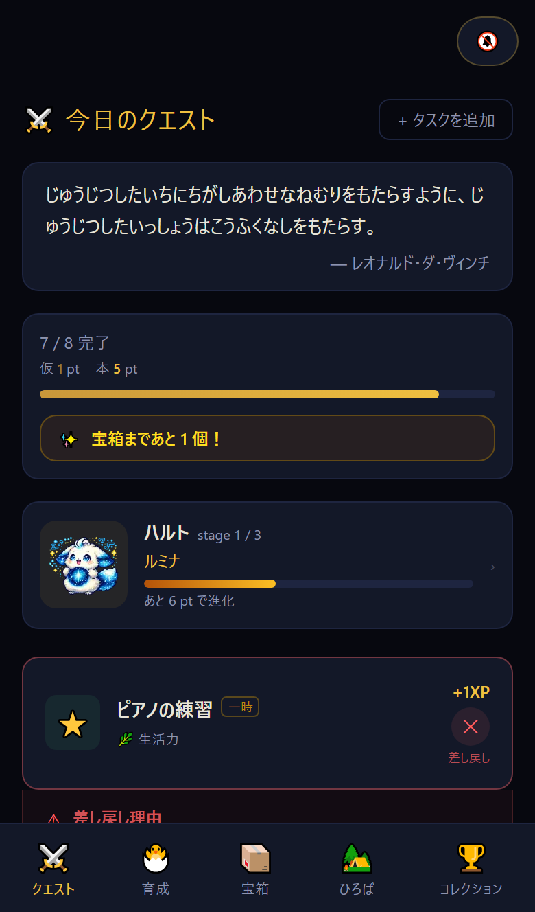

---

## 6. じぶんで タスクを ふやす

「+ タスクを追加」を おすと、じぶんで タスクを つくれるよ。

| えらぶ もの | どんな タスク？ |
|---|---|
| ⚡ 一時タスク | きょう だけ でる タスク |
| 📅 通常タスク | まいしゅう くりかえす タスク |

1. 「タスク名を入力...」に なまえを かく。
2. 「追加する」を おす。

- 「これいじょうタスクをふやせないよ」と でたら、ママ・パパに おねがい しよう。

---

## 7. チェックイン と れんぞく きろく

### チェックイン
おうちの 人が じかんを きめて いる ときは、その じかんまでに アプリを ひらくと 「チェックイン成功！」に なるよ。

- 「今日はチェックイン済み！」と でたら できて いるよ。
- 「直近7日 チェックイン」で、1しゅうかんの きろくが みられるよ（🌟 = できた、😢 = できなかった）。

### れんぞく きろく
- まいにち クエストを おわらせると、「🔥 〇日連続」が のびるよ。
- 「育成」の がめんで、「今月」と 「最高」の 日すうも みられるよ。
- 「あと〇日で「〇〇」」と でて いたら、その 日すう つづけると **しょうごう（称号）** が もらえるよ。
- ログインが つづくと、「ログインボーナス」で ポイントが もらえる ことも あるよ。

---

## 8. モンスターを そだてる

「🐣 育成」で じぶんの モンスターを みよう。

▼ そだてる がめん

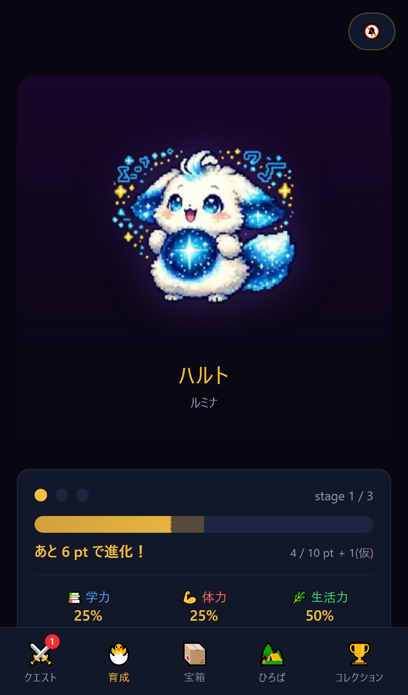

### ポイントで そだつ
クエストで もらった ポイントで モンスターが そだつよ。

- 「あと 〇 pt で孵化！」「あと 〇 pt で進化！」と、つぎまでの ポイントが でるよ。
- 「(仮)」の ポイントは、おうちの 人の OK まちの ぶん だよ。

### 3つの ちから
| ちから | どんな クエスト？ |
|---|---|
| 📚 学力 | べんきょう |
| 💪 体力 | うんどう |
| 🌿 生活力 | おてつだい・みのまわりの こと |

どの クエストを たくさん やったかで、しんかする すがたが かわるよ。

### そだちかた
1. たまご → うまれる（孵化）
2. しんか（進化）
3. もう いちど しんか して 「最終形態」に なる

### てんせい（転生）
「最終形態」に なった あとも ポイントを ためると、「✨ 転生の準備ができた！」と でるよ。

1. 「✨ 転生する！」を おす。
2. 「卵を選ぼう」で たまごを えらぶ。

| たまご | どうなる？ |
|---|---|
| ふつうの卵 | ボーナス なし |
| 勉強の卵 | 📚 学力の すがたに なりやすい |
| 体力の卵 | 💪 体力の すがたに なりやすい |
| 生活力の卵 | 🌿 生活力の すがたに なりやすい |

- また たまごから そだてなおすよ。そだてた モンスターは ずかんに のこるよ。
- あとで えらびたい ときは 「キャンセル（後でする）」を おそう。

---

## 9. たからばこ と ごほうび

### たからばこが もらえる とき
- きょうの クエストを きめられた かずだけ ほうこく すると、たからばこが でるよ。
- きょうの クエストを **ぜんぶ** ほうこく すると、もう 1こ もらえるよ。
- 「⚔ クエスト」の がめんで、たからばこまで あと いくつか みられるよ。

▼ おうちの人の OK まち

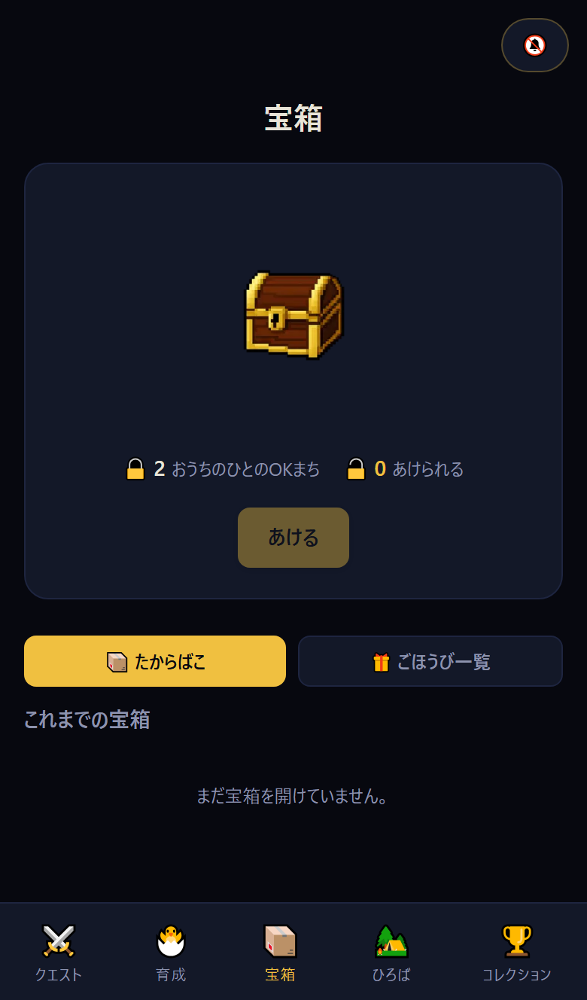

▼ クエストの がめんの 「あける」

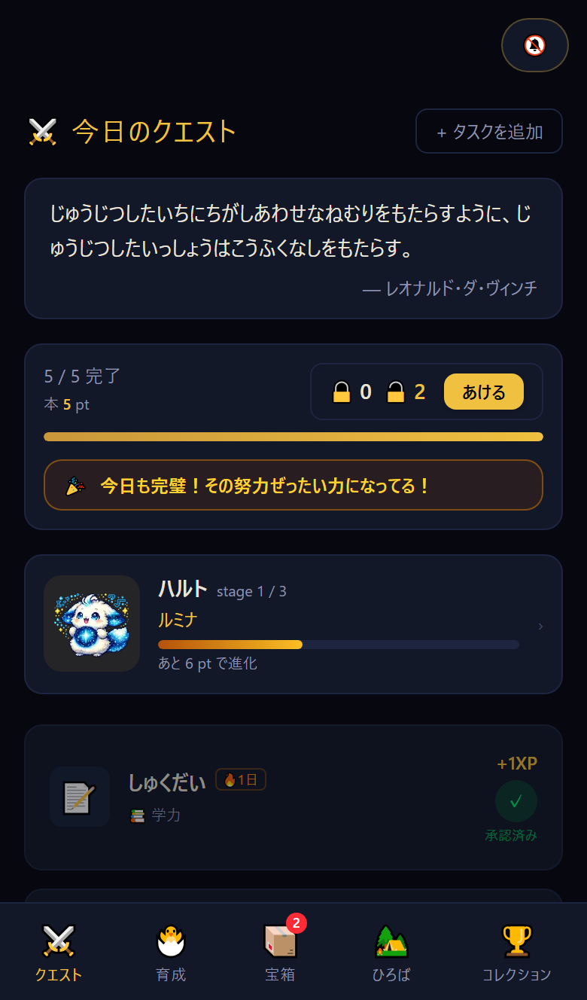

### たからばこを あける
「📦 宝箱」を おして、「📦 たからばこ」の ところを みよう。

| しるし | いみ |
|---|---|
| 🔒 おうちの人のOKまち | まだ あけられないよ。おうちの 人の OK を まとう |
| 🔓 あけられる | 「あける」を おすと あくよ |

- なかみは おうちの 人が きめた **ごほうび** か、きせつの **コレクションアイテム** だよ。
- ごほうびには ほしが ついて いるよ（🌟 よく でる → 🌟🌟🌟 めったに でない）。
- 「★ ボーナス」が ついた たからばこは、ごほうびが でやすいよ。
- 「これまでの宝箱」で、いままで あけた ものが みられるよ。

▼ あけられる たからばこ

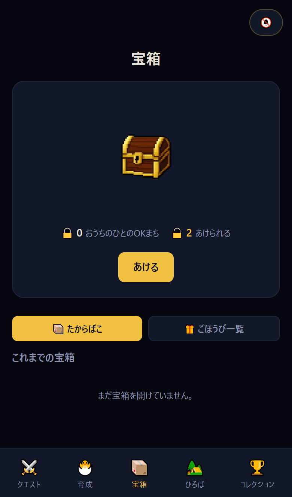

▼ ごほうびが でた ところ

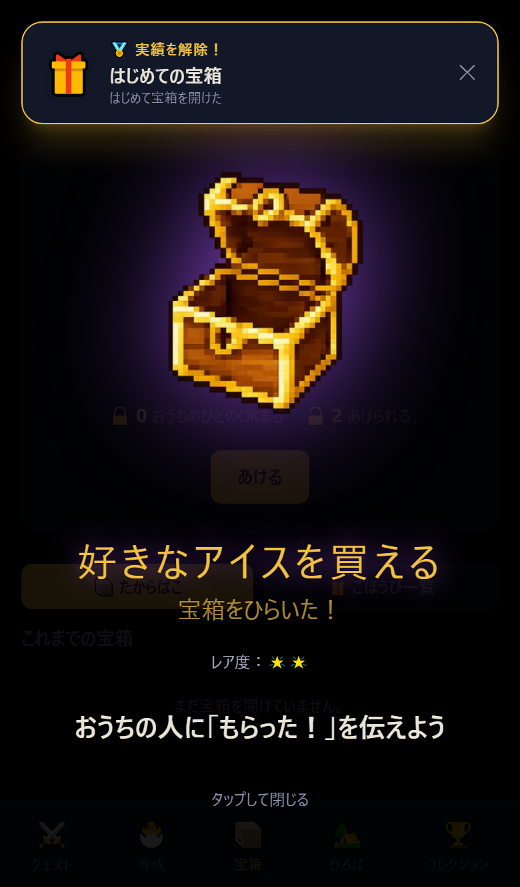

▼ コレクションが でた ところ

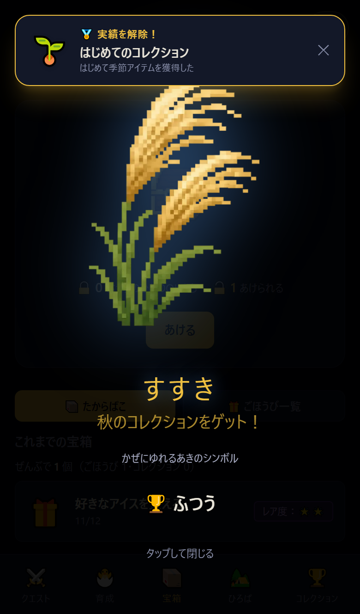

### ごほうびを つかう
1. 「🎁 ごほうび一覧」を おす。
2. つかいたい ごほうびの 「つかう」を おす。
3. 「つかっていい？」と きかれたら 「つかう」を おす。
4. 「しんせいちゅう」に なるよ。おうちの 人が OK すると 「つかったよ」に なるよ。

- **しんせい したら じぶんでは とりけせないよ。** まちがえた ときは おうちの 人に いおう。
- ごほうび一覧に でるのは、あけてから **30日** までの ものだよ。

▼ ごほうび いちらん

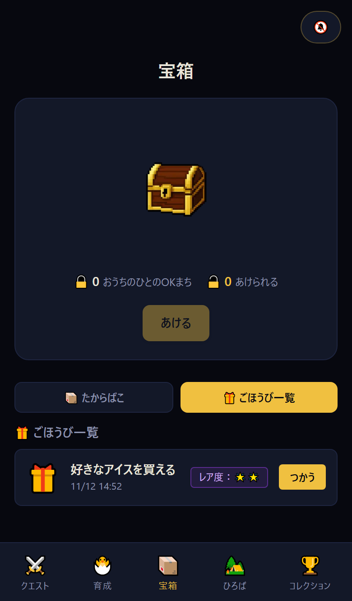

▼ 「つかう」を おした ところ

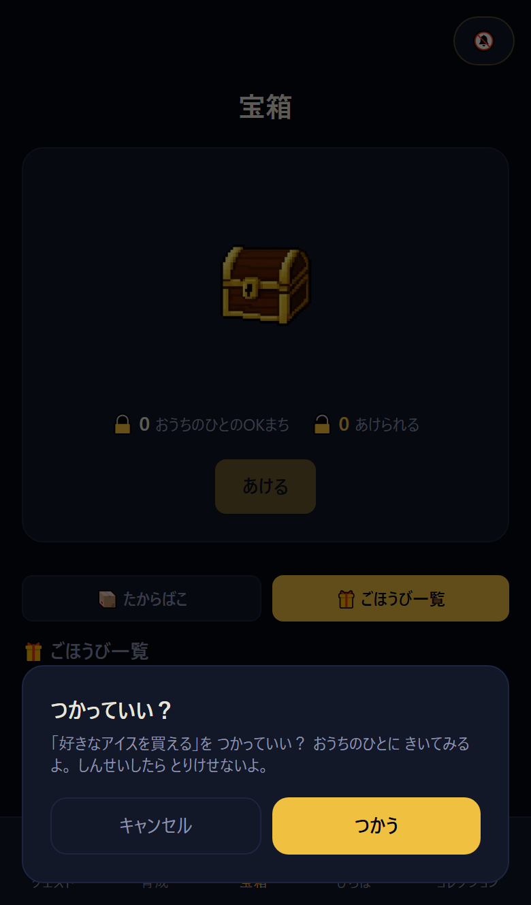

---

## 10. コレクション

「🏆 コレクション」には 3つの ページが あるよ。

| ページ | なにが みられる？ |
|---|---|
| 📖 図鑑 | いままで そだてた モンスター（「〇 / 〇 体」） |
| 🎁 アイテム | たからばこで もらった コレクションアイテム |
| 🏅 実績 | クエストで もらえる バッジ |

▼ モンスター図鑑

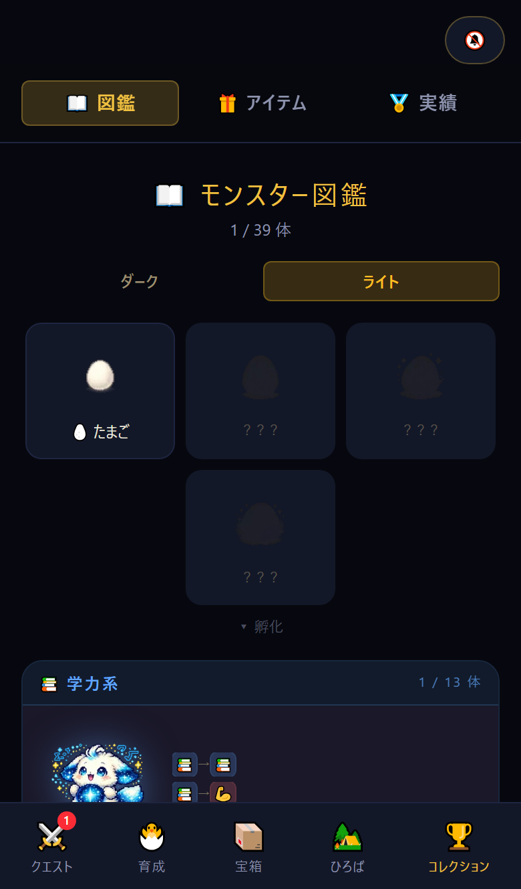

### アイテム
- 🌸はる・🌻なつ・🍁あき・❄️ふゆ の アイテムが あるよ。
- 「つうじょう」と 「げんてい」が あるよ。「月げんてい」は、その 月に しか でない アイテム だよ（「のこり〇日！」）。
- まだ もって いない アイテムは 「？？？」に なって いるよ。
- アイテムを タップ すると、「これまでに 〇 回ゲットしたよ！」が みられるよ。

▼ アイテム

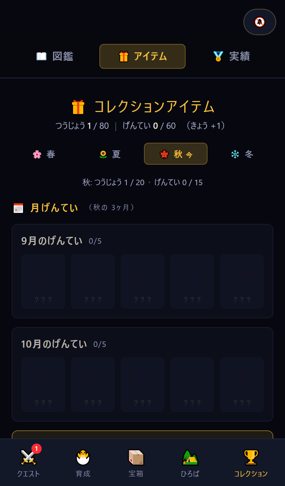

### 実績（バッジ）
- 「すべて」「解除済み」「未解除」で きりかえられるよ。
- 🔒の バッジは まだ もって いないよ。「あと 〇 で解錠」と でて いるよ。

▼ 実績

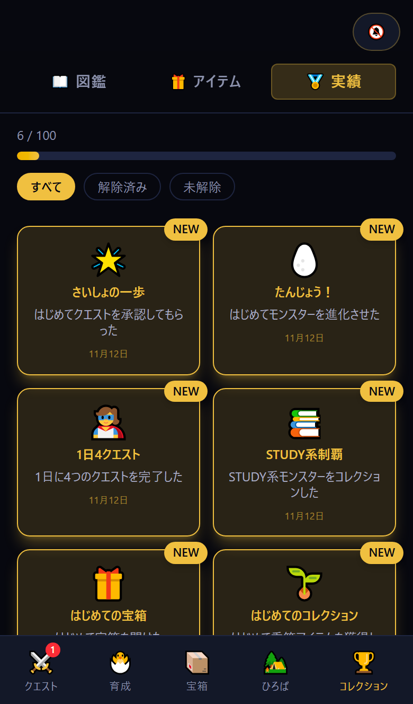

---

## 11. ひろば

ともだちと おなじ 「場所」と 「合言葉」を えらぶと、なかまに なれるよ。

### あつまる
1. 「場所」を えらぶ（🌳 公園 / 🏫 児童館 / ⛳ 校庭）。
2. 「合言葉」を 入れる（10もじ まで）。ひらがなと カタカナは おなじに なるよ。
3. 「あつまる！」を おす。

- なかまに なると、「〇/〇人 あつまっている」と でるよ。
- やめる ときは 「ぬける」を おそう。

▼ ひろばの がめん

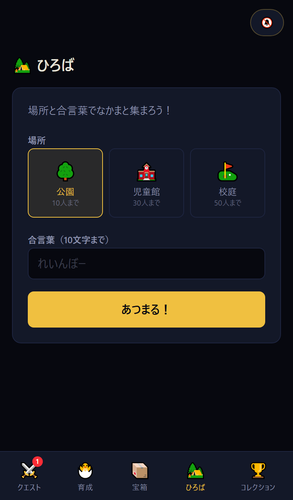

### エールを おくる
- 「📣 みんなにエールを送る」を おすと、なかまに エールが とどくよ。
- **1日 1回** まで だよ。
- なかまからも エールが とどくよ。

### けいじばん
- クエストを おわらせると、けいじばんに じどうで きろくが でるよ。

---

## 12. こまった とき

**Q. ログイン できない**
コードは 10分で つかえなく なるよ。1回 つかった コードも だめ だよ。おうちの 人に あたらしい コードを もらおう。

**Q. 「うまく送れなかったよ。もういちどためしてね」と でた**
インターネットに つながって いるか みて、もう いちど おそう。

**Q. ポイントが ふえない**
おうちの 人が OK するまで、ポイントは 「(仮)」の ままだよ。

**Q. たからばこが あけられない**
「🔒 おうちの人のOKまち」の ときは、おうちの 人の OK を まとう。

**Q. ごほうびの 「つかう」を まちがえて おした**
じぶんでは とりけせないよ。おうちの 人に 「まちがえた」と いおう。

**Q. タスクを ふやせない**
もう いっぱい だよ。ママ・パパに おねがい しよう。
