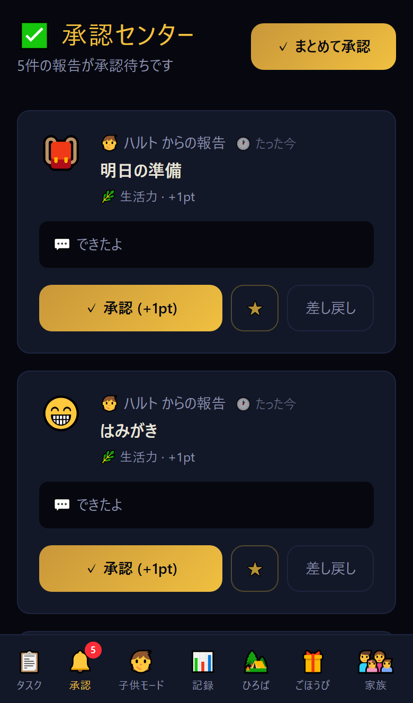
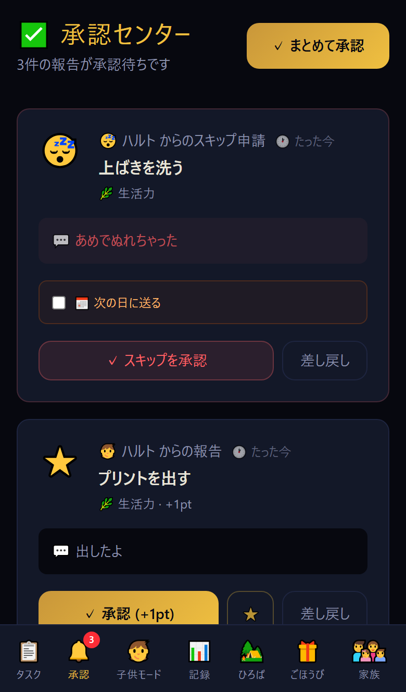
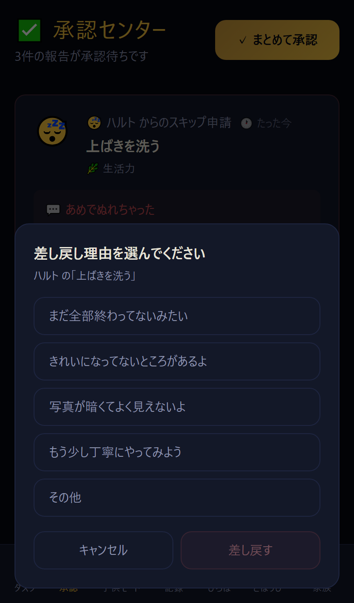

# 承認センター

子どもがタスクを「やったよ」と報告したり、「今日はできない」とスキップを申請したりすると、親の **承認センター** に届きます。親が内容を確認して承認すると、子どもに XP（ポイント）が入り、モンスターが育ちます。

この章では、報告・スキップ申請の確認、承認と差し戻し、まとめて承認、承認したときに何が起きるかを説明します。

---

## 1. 全体の流れ

```
子どもがタスクを報告（写真・コメント付きのこともある）
  → 親のスマホに通知「✅ クエスト報告」
  → 承認センターに届く
  → 親が選ぶ
      ✓ 承認     → XP が入る・モンスターが育つ・宝箱が開けられるようになる
      差し戻し   → 理由を付けて子どもに返す → 子どもがやり直して再報告

子どもがスキップを申請（理由を書く）
  → 親のスマホに通知「😴 スキップ申請」
  → 承認センターに届く
  → 親が選ぶ
      ✓ スキップを承認 → その日のタスクは「スキップ」で確定（XP はなし）
      差し戻し         → 未報告に戻る（子どもはもう一度報告かスキップ申請ができる）
```

承認センターは、ナビの **✅ 承認** から開きます。

---

## 2. タスクの状態

1つのタスクは、その日のうちに次の状態をたどります。

| 状態 | 子どもの画面の表示 | 意味 |
|---|---|---|
| 未報告 | （ボタンのみ） | まだ報告もスキップ申請もしていない |
| 承認待ち（報告） | ✓ 確認中... | 子どもが報告し、親の確認を待っている |
| 承認済み | ✓ 承認済み（スタンプ付きならスタンプ） | 親が承認した。XP が入っている |
| 差し戻し | ✕ 差し戻し ＋ 差し戻し理由 | 親がやり直しを求めた |
| 承認待ち（スキップ申請） | − 申請中... | 子どもがスキップを申請し、親の確認を待っている |
| スキップ | − スキップ | 親がスキップを承認した |

### 状態が変わる操作

| 今の状態 | 操作 | 次の状態 |
|---|---|---|
| 未報告 | 子どもが報告 | 承認待ち（報告） |
| 未報告 | 子どもがスキップ申請 | 承認待ち（スキップ申請） |
| 承認待ち（報告） | 親が ✓ 承認 | 承認済み |
| 承認待ち（報告） | 親が差し戻し | 差し戻し |
| 差し戻し | 子どもが再報告 | 承認待ち（報告） |
| 差し戻し | 子どもがスキップ申請 | 承認待ち（スキップ申請）。差し戻し理由は消えます |
| 承認待ち（スキップ申請） | 親が ✓ スキップを承認 | スキップ |
| 承認待ち（スキップ申請） | 親が差し戻し | 未報告 |

- **承認済み・スキップになったタスクは、元に戻せません。** 承認する前に内容を確認してください。
- 別の端末ですでに承認・差し戻ししたタスクを操作すると、「処理に失敗しました。通信状況を確認して、もう一度お試しください」と出て、一覧が最新の状態に更新されます。

---

## 3. 承認待ちの件数と通知

### ナビの赤い数字
ナビの **✅ 承認** に、承認待ちの件数が赤い丸で表示されます（100件以上は「99+」）。

数えているのは、家族全員の子どもの次の合計です。
- タスクの報告
- スキップ申請
- ごほうびの使用申請（[宝箱とごほうび](treasures.md#6-子どもがつかうを申請したとき) を参照）

件数は、子どもが報告したときや、アプリを開き直したときに自動で更新されます。

> ナビの **📋 タスク** にも赤い数字が出ることがあります。こちらは子どもが自分で作ったタスクの数で、承認センターとは別です。

### スマホへの通知
通知を許可している場合、次のタイミングで親のスマホに通知が届きます。タップすると承認センターが開きます。

| 通知 | タイミング |
|---|---|
| ✅ クエスト報告 —「〇〇が「（タスク名）」を完了しました」 | 子どもがタスクを報告したとき |
| 😴 スキップ申請 —「〇〇が「（タスク名）」のスキップを申請しました」 | 子どもがスキップを申請したとき |
| 🎁 ごほうび使用申請 | 子どもがごほうびの「つかう」を申請したとき |

---

## 4. 承認センターの見方

画面上部に「〇件の報告が承認待ちです」と出ます。その下に、届いた順（新しいものが上）でカードが並びます。子どもが2人以上いる場合も、全員分が1つの一覧にまとまります。

### 報告のカード
| 項目 | 内容 |
|---|---|
| 🧒 〇〇 からの報告 🕐 時刻 | 誰がいつ報告したか |
| タスク名 | 報告されたタスク |
| 📚 学力 / 💪 体力 / 🌿 生活力 · +1〜3pt | カテゴリと、このタスクでもらえる XP の幅 |
| 写真 | 写真付きで報告された場合に表示。**タップすると大きく表示**され、もう一度タップすると閉じます |
| 💬 コメント | 子どもが書いたコメント |

### スキップ申請のカード
- 赤い枠で、アイコンは 😴 です。
- 「😴 〇〇 からのスキップ申請」と出ます。
- 💬 の欄に、子どもが書いたスキップの理由が出ます（スキップ申請には理由の入力が必須です）。

### 何もないとき
「🎉 全部確認できました！おつかれさま」と出ます。「タスクへ戻る」でタスク画面に戻れます。

▼ 承認センター（報告のカード）



▼ 承認センター（スキップ申請のカードと報告のカード）



---

## 5. 承認する

報告のカードで **✓ 承認 (+〇pt)** を押します。ボタンに出る数字が、子どもに入る XP です。

### もらえる XP の内訳

| 内容 | XP | 条件 |
|---|---|---|
| 基本 | +1 | いつでも |
| 期限ボーナス | +1 | **ファミリー設定 → ⏰ 報告期限** を設定していて、その時刻より前に報告した |
| 写真ボーナス | +1 | タスクで写真ボーナスを有効にしていて、写真付きで報告した |
| 今日やる宣言ボーナス | +1 | 子どもがそのタスクに「今日やる」と宣言した日に報告した |

- XP はタスクのカテゴリ（学力・体力・生活力）に入ります。
- 期限ボーナスは **最初に報告したとき** の時刻で決まります。差し戻し後の再報告では変わりません。
- XP が入るのは **承認したとき** です。報告しただけでは入りません。

### スタンプを付けて承認する
1. **⭐** ボタンを押します。
2. スタンプを選びます。

   | スタンプ | 言葉 |
   |---|---|
   | ⭐ | よくできた |
   | 🎉 | すごい |
   | 👏 | えらい |
   | 💪 | がんばった |
   | 🌟 | さすが |
   | ❤️ | うれしい |
   | 🏆 | 完璧 |
   | 🎯 | ぴったり |

3. 「〇 承認する」を押します。スタンプを選ばずに「✓ 承認する」を押すと、スタンプなしで承認されます。

子どもの画面では、承認済みのタスクにスタンプが表示されます。

---

## 6. 承認したときに起きること

### 報告を承認したとき
1. **XP が入ります。** モンスターが進化する条件を満たしていれば、進化します。
   - 転生を待っている状態（モンスターが最終段階に達して、子どもが転生の操作をする前）のときは、XP だけが入り、進化は起きません。
2. **ストリーク（連続達成日数）が更新されます。** その日に承認・スキップしたタスクの数が「ストリーク最低タスク数」に届いた時点で、その日が達成日になります。
   - その日のタスクが最低タスク数より少ない日は、全部終われば達成です。
   - 連続日数が節目に届くと、ボーナス XP と称号がもらえます。
3. **タスクごとの連続記録が更新されます**（毎週くり返すタスクのみ。一時タスクは対象外）。
4. **その日の宝箱が開けられるようになります**（[宝箱とごほうび](treasures.md#宝箱が開けられるようになるタイミング)）。
5. **バッジ（実績）の条件をチェックします。** 条件を満たしたバッジがもらえます。
6. **子どもが自分で作ったタスクを承認した場合**、そのタスクは親が作ったタスクと同じ扱いになります。

進化・バッジ・ストリークの称号は、ひろばの掲示板にも流れます。

### スキップを承認したとき
- XP は入りません。
- ストリークの達成数には **数えます**（スキップを承認した分も「その日のタスクを片づけた」扱いになります）。
- タスクごとの連続記録には数えません。
- その日の宝箱は開けられるようになります。

---

## 7. 差し戻す

報告に問題があるときは、**差し戻し** を押します。

1. 「差し戻し理由を選んでください」から理由を1つ選びます。理由はタスクのカテゴリで変わります。

   | カテゴリ | 選べる理由 |
   |---|---|
   | 📚 学力 | 宿題のページが違うよ / まだ全部終わってないみたい / 字が読めないよ、書き直してね / 写真が暗くてよく見えないよ / その他 |
   | 💪 体力 | 時間が短すぎるよ、もう少しやってみよう / まだ全部終わってないみたい / 写真や動画をつけてね / 別のことをやってたみたい / その他 |
   | 🌿 生活力 | まだ全部終わってないみたい / きれいになってないところがあるよ / 写真が暗くてよく見えないよ / もう少し丁寧にやってみよう / その他 |

2. 「その他」を選んだ場合は、理由を入力します（必須）。入力した文がそのまま子どもに表示されます。
3. **差し戻す** を押します。やめるときは「キャンセル」を押します。

▼ 差し戻し理由を選ぶ画面



### 差し戻したときに起きること
- 子どもの画面に「✕ 差し戻し」と **差し戻し理由**、「タップしてもう一度報告してね」が出ます。
- XP は入りません（もともと承認前なので、減ることもありません）。
- 差し戻しで、その日の宝箱の条件を満たさなくなった場合は、まだ開けていない宝箱が消えます（[宝箱とごほうび](treasures.md#差し戻すと宝箱はどうなるか)）。
- 子どもはやり直して再報告するか、スキップを申請できます。

---

## 8. スキップ申請に対応する

### スキップを承認する
**✓ スキップを承認** を押します。その日のタスクは「スキップ」で確定します。

### 一時タスクを別の日に送る
一時タスク（その日だけのタスク）のスキップ申請には、**📅 次の日に送る** のチェックボックスが出ます。

1. チェックを入れると日付の欄が出ます（初期値は翌日。今日以前は選べません）。
2. 送り先の日付を選びます。
3. **✓ スキップを承認** を押すと、スキップが確定し、同じタスクが選んだ日に作られます。

- 無料プランでタスクの上限に達している場合、スキップの承認はされますが、別の日へのコピーはされません。上限の案内が出ます。
- スキップを承認したあとでも、記録画面の「🏆 今日」から別の日に送れます（[記録・履歴](records.md#一時タスクを別の日に送る)）。

### スキップ申請を差し戻す
**差し戻し** を押して理由を選び、**差し戻す** を押します。タスクは未報告に戻り、子どもはもう一度報告かスキップ申請ができます。

- スキップ申請を差し戻した場合、子どもが書いたスキップの理由は消えます。
- スキップ申請の差し戻しでは、選んだ差し戻し理由は子どもの画面に表示されません。必要なら口頭で伝えてください。

---

## 9. まとめて承認する

承認待ちが1件以上あるとき、画面右上に **✓ まとめて承認** が出ます。

1. **✓ まとめて承認** を押します。
2. 「〇件をまとめて承認します。よろしいですか？」と出ます。
3. **承認する** を押します。やめるときは「やめる」を押します。

### まとめて承認の対象
| 種類 | まとめて承認したときの扱い |
|---|---|
| タスクの報告 | 承認（スタンプなし） |
| スキップ申請 | スキップを承認（**別の日に送る** は行われません） |
| ごほうびの使用申請 | 使用を承認 |

- 対象は、**確認画面を開いた時点で一覧にあったもの** です。確認中に新しく届いた報告は含まれません。
- 古い日付のタスクから順に承認します。
- 対象のうち1件でもすでに別の端末で処理されていた場合は、エラーになり、何も承認されません。一覧が更新されるので、もう一度 **✓ まとめて承認** を押してください。
- スタンプを付けたい報告、差し戻したい報告、別の日に送りたいスキップ申請は、先に個別に処理してから、残りをまとめて承認してください。

---

## 10. 承認し忘れたとき（自動承認）

毎日 **0:00** に、**前日以前** のタスクで承認待ちのまま残っているものを自動で承認します。

| 種類 | 自動承認の扱い |
|---|---|
| タスクの報告 | 承認（XP が入る。スタンプなし） |
| スキップ申請 | スキップを承認 |
| ごほうびの使用申請 | 前日以前に申請されたものを承認 |

- 自動承認されたタスクも、手で承認したときと同じように XP・ストリーク・宝箱・バッジが処理されます。
- 差し戻したいものがある場合は、その日のうちに対応してください。

---

## よくある質問

**Q. 承認したのにモンスターが進化しない**
モンスターが転生できる状態（転生待ち）になっていると、XP は入りますが進化は起きません。子どもの画面で転生の操作をすると、また育て始められます。

**Q. 間違えて承認してしまった。取り消したい**
承認したタスクは元に戻せません。ごほうびの使用承認だけは、「もらった履歴」で取り消せます（[宝箱とごほうび](treasures.md#使用済みを取り消す)）。

**Q. 間違えて差し戻してしまった**
子どもにもう一度報告してもらってください。再報告されると承認待ちに戻ります。期限ボーナスは最初の報告時刻で決まるので、再報告で失われることはありません。

**Q. 「処理に失敗しました」と出る**
通信が切れているか、別の端末（もう1人の親など）がすでに処理した可能性があります。一覧は自動で最新になるので、表示を確認してからもう一度操作してください。

**Q. 承認ボタンの pt が子どもの画面と違う**
承認センターのボタンは、写真・期限・今日やる宣言のボーナスを含めた実際の XP です。子どもの画面の報告前の表示は「もらえる可能性がある幅」です。

**Q. 昨日の報告を承認し忘れた**
0:00 に自動で承認されています。記録画面の「📅 過去」で確認できます。

**Q. まとめて承認したらスタンプが付かなかった**
まとめて承認ではスタンプは付きません。スタンプを付けたい報告は ⭐ から個別に承認してください。
