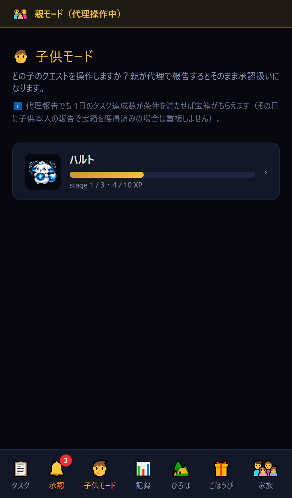
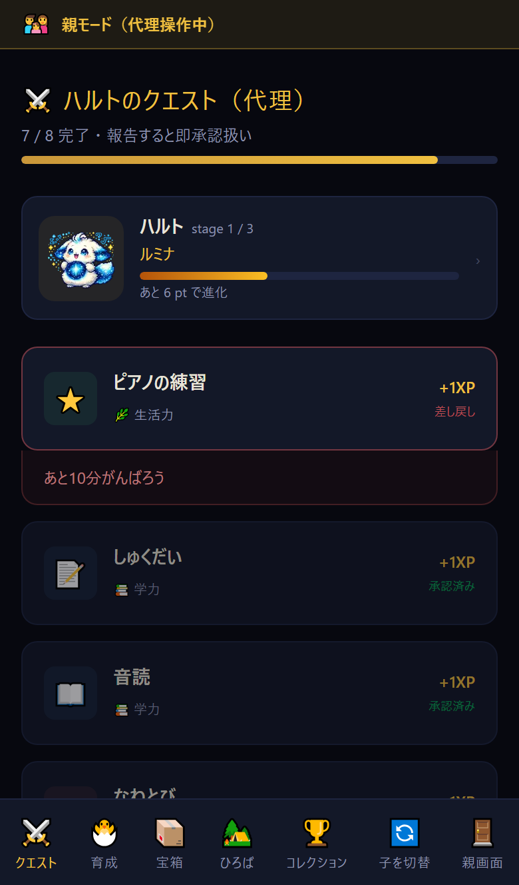
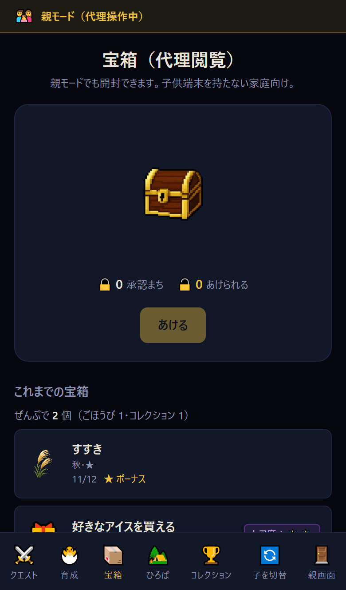
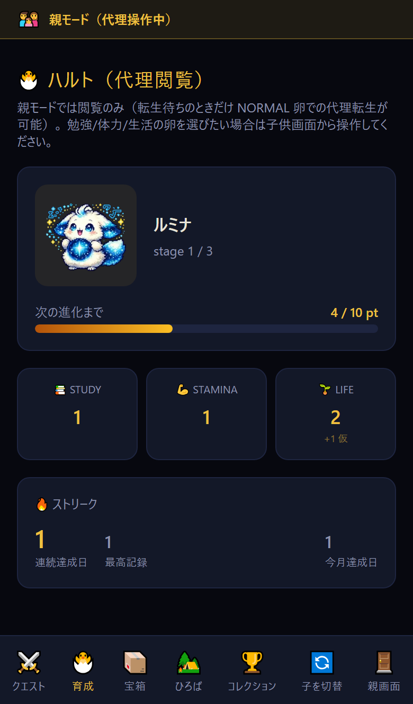

# 子供モード（親の代理操作）

子供モードは、おうちの人が子どもの代わりにクエストを報告したり、宝箱を開けたりする機能です。子どもが自分の端末を持っていないときや、報告を忘れた日にまとめて記録したいときに使います。

この章では、子供モードでできること、通常の報告・承認との違い、子供モードではできないことを説明します。

---

## 1. 全体の流れ

```
ナビの 🧒 子供モード を開く
  → 操作する子どもを選ぶ
  → 子どもの画面と同じ見た目で、代わりに操作する
     ・クエストを報告する → その場で承認済みになる
     ・クエストをスキップする → その場でスキップ確定になる
     ・宝箱を開ける
     ・転生待ちのときに転生する（ふつうの卵のみ）
  → 下のナビの 🚪 親画面 で親の画面に戻る
```

子供モードで報告すると、子どもが報告して親が承認するのと同じ結果（XP・進化・バッジ・ストリーク）になります。承認待ちの段階はありません。

---

## 2. 子供モードを開く

1. 親のナビの **🧒 子供モード** を押します。
2. 子どもの一覧が出ます。各子どものカードには、モンスターの画像、名前、次の進化（または転生）までの XP が表示されます。
3. 操作する子どものカードを押すと、その子の **クエスト** 画面が開きます。

- 子どもが1人も登録されていないときは「まだ子供が登録されていません。」と表示されます。**ファミリー画面** から子どもを追加してください。
- 子供モード中は、画面の上に **👨‍👩‍👧 親モード（代理操作中）** と表示されます。

▼ 子供モードの子ども選択画面



### 子供モードの下のナビ

| ボタン | 開く画面 |
|---|---|
| ⚔️ クエスト | 今日のクエストの代理報告・スキップ |
| 🐣 育成 | モンスターの状態（閲覧のみ。転生待ちのときだけ代理転生） |
| 📦 宝箱 | 宝箱を開ける・これまでの宝箱を見る |
| 🏕️ ひろば | 子どもが参加しているひろば（閲覧のみ） |
| 🏆 コレクション | 図鑑・アイテム・実績（閲覧のみ） |
| 🔄 子を切替 | 子どもの選択画面に戻る |
| 🚪 親画面 | 親のタスク画面に戻る |

---

## 3. クエストを代理で報告する

**⚔️ クエスト** 画面には「〇〇のクエスト（代理）」と、今日のクエストの一覧が出ます。上部に「完了数 / 全体 完了 ・ 報告すると即承認扱い」と表示されます。

### 報告の手順
1. 報告するクエストのカードを押します。
2. 報告画面が開きます。必要なら次を入力します。
   - 📷 写真（写真ボーナスが付いたタスクのみ。写真を付けると +1 XP）
   - 💬 コメントを追加（なくても報告できます）
3. **⚔ クエスト完了！** を押します。
4. その場で **承認済み** になり、XP が加算されます。

### 表示される一覧
- 今日のクエストに加えて、「持ち越し」設定のタスクで前の日に終わっていないもの（未報告のもの）も表示されます。
- 一時停止中のタスクや削除したタスクは表示されません。

▼ 子供モードのクエスト画面



### 各カードの状態と押したときの動き

| カードの表示 | 状態 | 押したとき |
|---|---|---|
| ○（丸だけ） | まだ報告していない | 報告画面が開く。報告すると承認済みになる |
| タップで確定 | 子どもが報告済みで、親の承認待ち | 報告画面が開く。報告すると承認済みになる |
| 差し戻し（赤枠） | 親が差し戻した | 報告画面が開く。報告すると承認済みになる |
| 承認済み | 承認済み | 押せない |
| スキップ | スキップ確定 | 押せない |
| （薄く表示・押せない） | 子どもがスキップを申請中 | 押せない（[6. できないこと](#6-子供モードではできないこと) を参照） |

- 子どもが報告済みのクエストを確定するとき、新しくコメントや写真を入れなければ、子どもが付けたコメント・写真がそのまま残ります。
- 差し戻したクエストを代理で報告すると、差し戻しの理由は消えます。

### XP の計算
各カードの右に、そのクエストで入る XP が表示されます。

| 内容 | XP |
|---|---|
| 基本 | +1 |
| 期限までに報告した（期限設定がある場合） | +1 |
| 写真を付けた（写真ボーナスがあるタスク） | +1 |
| 子どもがその日「今日やる」と宣言していた | +1 |

- 期限ボーナスは、**まだ報告していないクエストを代理で報告したとき** に、その時刻が期限より前かどうかで決まります。子どもが報告済み・差し戻し済みのクエストは、最初の報告時の判定がそのまま使われます。

### 進化したとき
代理報告でモンスターが進化・孵化した場合は、子供モードの画面でも進化のカットインが表示されます。

---

## 4. クエストを代理でスキップする

1. スキップするクエストのカードを押します。
2. 報告画面の下にある **😴 今日はスキップする** を押します。
3. 理由を選ぶか入力します（必須）。

   | 選べる理由 |
   |---|
   | ⏰ 時間がなかった |
   | 🙅 今日はできなかった |
   | 😴 つかれた |
   | 😅 わすれちゃった |
   | 🤒 たいちょうがわるい |

   選択肢にない理由は「理由を入力（必須）」欄に書けます。
4. **😴 スキップを申請する** を押します。

- ボタンの表示は「申請する」ですが、子供モードでは承認待ちにならず、その場で **スキップ確定** になります。
- スキップ確定にできるのは「まだ報告していない」クエストだけです。差し戻したクエストはスキップできません（エラー「このクエストはスキップできません」が出ます）。

---

## 5. 宝箱・モンスター・ひろば・コレクション

### 📦 宝箱
画面のタイトルは「宝箱（代理閲覧）」です。子どもの宝箱画面と同じように **あける** を押すと宝箱を開けられます。

- 宝箱の状態は 🔒「承認まち」/ 🔓「あけられる」で表示されます。
- 開けた宝箱の中身は、子どもの画面の「これまでの宝箱」にも同じように残ります。
- ごほうびの「つかう」申請は子供モードからはできません。使用状況（✅ つかったよ / ⏳ しんせいちゅう）の表示のみです。ごほうびの使用済み処理は **🎁 ごほうび → 🎁 もらった履歴** で行います（[宝箱とごほうび](treasures.md) を参照）。

▼ 子供モードの宝箱画面



#### 代理報告で出る宝箱
子供モードで報告・スキップした場合も、その日の条件を満たせば宝箱が出ます。

- 承認待ちの段階がないため、最初から 🔓「あけられる」の状態で出ます。
- その日に子ども本人の報告ですでに「ふつうの宝箱」をもらっている場合、代理報告では重複して出ません。
- その日のタスクを全部終えたときの「全部クリアの宝箱」は、代理報告でも出ます。スキップが1件もなければ「★ ボーナス」付きです。
- 条件の詳細は [宝箱とごほうび](treasures.md) の「2. 宝箱がもらえる条件」を参照してください。

### 🐣 育成
「〇〇（代理閲覧）」として、モンスターの状態を見られます。

- 進化の段階、次の進化（または転生）までの XP
- 📚 STUDY / 💪 STAMINA / 🌱 LIFE のポイント。子どもが報告済みで承認前のポイントは「+〇 仮」と表示されます。
- 🔥 ストリーク（連続達成日・最高記録・今月達成日）

▼ 子供モードの育成画面



#### 代理で転生する
モンスターが **転生待ち** のときだけ、**🥚 代理で転生する（NORMAL 卵）** ボタンが出ます。

- 代理転生では、卵は必ず **NORMAL 卵（ボーナスなし）** になります。勉強・体力・生活の卵を選びたい場合は、子どもの画面から転生してください。
- 転生待ちのままにしておくと、XP は加算されますが進化は止まります。
- 親の画面でモンスターのテーマを変更予約している場合は、この転生で新しいテーマに切り替わります。
- 子どもが先に自分で転生していた場合は「転生の準備ができていません」と表示され、子どもの選んだ卵がそのまま使われます。

### 🏕️ ひろば
「ひろば（代理閲覧）」として、子どもが参加しているグループの場所・合言葉・人数、なかま一覧、掲示板を見られます。閲覧のみで、エールを送ったりグループに参加・退出したりはできません。詳しくは [ひろば](gathering.md) を参照してください。

### 🏆 コレクション
📖 図鑑 / 🎁 アイテム / 🏅 実績 の3つのタブで、子どもが集めたものを見られます。閲覧のみです。

---

## 6. 子供モードではできないこと

| できないこと | 代わりの方法 |
|---|---|
| クエストを差し戻す | 承認センターで差し戻す |
| 子どもが申請中のスキップ（SKIP_REPORTED）を確定・却下する | 承認センターでスキップを承認・却下する |
| 差し戻したクエストをスキップにする | 承認センター経由で子どもにスキップ申請してもらう |
| 転生時に勉強・体力・生活の卵を選ぶ | 子どもの画面から転生する |
| ごほうびの「つかう」を申請する | 親の「もらった履歴」で「つかった」を押す |
| ひろばへの参加・退出、エールを送る | 子どもの画面から操作する |
| 他の家族の子どもを操作する | できません（自分の家族の子どもだけが表示されます） |

---

## 7. 通常の報告・承認との違い

| | 子どもが報告 → 親が承認 | 子供モードで代理報告 |
|---|---|---|
| 承認待ち | あり（承認センターに届く） | なし（その場で承認済み） |
| スキップ | 子どもが申請 → 親が承認 | その場でスキップ確定 |
| 宝箱 | 報告時は 🔒、承認で 🔓 | 最初から 🔓 |
| XP・進化・バッジ・ストリーク | 承認時に反映 | 代理報告時に反映 |
| ひろばの掲示板（クエスト進捗） | 報告時に流れる | 代理報告でも同じように流れる |
| 画面の自動更新 | 子どもの画面はリアルタイムに更新される | 自動更新されない。最新の状態を見るには画面を開き直す |

---

## よくある質問

**Q. 子供モードで報告したのに承認センターに出てこない**
子供モードの報告はその場で承認済みになるため、承認センターには届きません。

**Q. 子どもがスキップを申請したクエストが押せない**
子供モードでは、子どもが申請中のスキップは確定できません。承認センターで承認または却下してください。

**Q. 代理で宝箱をもらったのに、子ども本人の報告ではもらえなかった**
「ふつうの宝箱」は1日1個です。代理報告と子ども本人の報告で、先に条件を満たした方の宝箱だけが出ます。

**Q. 代理で転生したら卵が選べなかった**
代理転生は NORMAL 卵（ボーナスなし）に固定です。卵を選びたいときは子どもの画面から転生してください。

**Q. 子どもの端末で操作した内容が子供モードに反映されない**
子供モードの画面は自動で更新されません。画面を開き直すと最新の状態になります。
