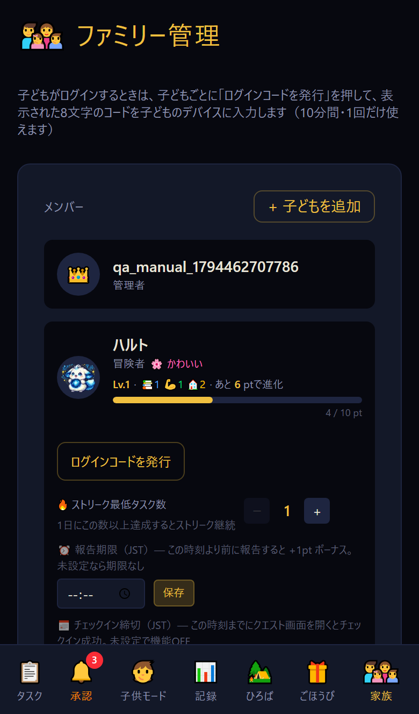
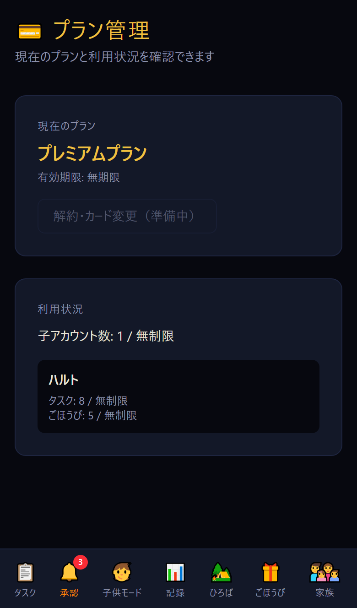

# ファミリー設定とプラン

**👨‍👩‍👧‍👦 ファミリー**（スマホでは「家族」）画面では、子どもの追加・設定・削除、ログインコードの発行、ログアウト、アカウントの削除ができます。**💳 プラン** 画面では、今のプランと、どれだけ使っているかを確認できます。

---

## 1. ファミリー管理画面の見方

画面には「メンバー」として、家族の全員がカードで並びます。

| 表示 | 意味 |
|---|---|
| 👑 管理者 | おうちの人 |
| 冒険者 🌸 かわいい / 🌑 かっこいい | 子どもと、そのモンスターのスタイル |

子どものカードには、モンスターの育ち具合も表示されます。

- `Lv.2 · 📚12 💪8 🏠5 · あと 15 ptで進化` のように、今の段階、ジャンルごとのポイント（📚 勉強・💪 運動・🏠 生活）、次の段階までの残りポイントが出ます。
- 次の段階は、卵のときは「孵化」、育成中は「進化」、最後の段階では「転生」と表示されます。
- その下のバーと `40 / 55 pt` は、次の段階までの進み具合です。

子どものカードの下には、子どもごとの設定が並んでいます。以下で順に説明します。

▼ ファミリー管理画面

---

## 2. 子どもを追加する

「メンバー」の右の「+ 子どもを追加」を押し、「なまえ」「スタイル」（必要なら「テーマ」）を入力して「追加」を押します。

詳しい手順と項目は [はじめに › 子どもを追加する](getting-started.md#5-子どもを追加する) を参照してください。

- なまえは 20 文字までです。空のままだと「名前を入力してください」と表示されます。
- 追加した後に名前を変える機能はありません。

---

## 3. ログインコードを発行する

子どもの端末でログインするためのコードを発行します。

1. 子どものカードの「ログインコードを発行」を押します。
2. 8 文字のコードと残り時間が表示されます。
3. 子どもの端末のログイン画面に入力してもらいます。

- コードは 10 分間・1 回だけ使えます。
- もう一度押すと（ボタンは「ログインコードを再発行」に変わります）新しいコードが出て、前のコードは使えなくなります。

詳しくは [はじめに › 子どもの端末でログインする](getting-started.md#6-子どもの端末でログインする) を参照してください。

---

## 4. 子どもごとの設定

設定はすべて子どもごとに別々です。変更はその場で保存されます（時刻の項目だけは「保存」ボタンを押します）。

### 🔥 ストリーク最低タスク数

「1日にこの数以上達成するとストリーク継続」となる数です。「−」「＋」で変えます。

| 項目 | 内容 |
|---|---|
| 初期値 | 1 |
| 設定できる範囲 | 1 〜 20 |

- この数は、宝箱がもらえる条件にも使われます（[宝箱とごほうび › 宝箱がもらえる条件](treasures.md#2-宝箱がもらえる条件)）。
- その日のタスクがこの数より少ない日は、全部報告すれば条件を満たしたことになります。
- 最初は小さい数から始めて、慣れてきたら増やすのがおすすめです。

### ⏰ 報告期限（JST）

「この時刻より前に報告すると +1pt ボーナス。未設定なら期限なし」です。

1. 時刻を入力します。
2. 「保存」を押します。
3. 期限をなくすときは「クリア」を押してから「保存」を押します。

- 時刻は日本時間です。
- ボーナスがつくかどうかは、**最初に報告した時刻** で決まります。差し戻されて報告し直した場合も、最初の報告で決まったボーナスのままです。
- ボーナスの XP が子どもに入るのは、おうちの人が承認したときです。
- 子どもの画面では、期限が設定されているとクエストに `+1〜2pt` のように、もらえる可能性のあるポイントの幅が表示されます。
- 保存に失敗すると「報告期限を保存できませんでした。もう一度お試しください」と表示されます。

### 📅 チェックイン締切（JST）

「この時刻までにクエスト画面を開くとチェックイン成功。未設定で機能OFF」です。設定方法は報告期限と同じです（時刻を入力して「保存」、なくすときは「クリア」→「保存」）。

- 子どもがその日はじめてクエスト画面を開いた時刻が締切より前なら、チェックイン成功です。連続日数が 1 増えます。
- 締切を過ぎてからはじめて開いた場合は失敗になり、連続日数は 0 に戻ります。
- 締切ちょうどの時刻に開いた場合は、失敗（締切を過ぎた）として扱います。
- 1 日に何回開いても、判定はその日の最初の 1 回だけです。
- 未設定にすると、チェックインの機能は動きません。

### 📣 クエストタイム自動通知

「JST 17:00 に未完了の子へ自動Push（追い詰めたくない子はOFFに）」です。ボタンを押すたびに ON / OFF が切り替わります。

- ON にすると、毎日 17:00 に、その日のクエストが終わっていない場合だけ子どもに通知が届きます。全部終わっている日は届きません。
- 通知の文面は、進み具合（まだ 0 件・途中・あと少し）によって変わります。
- 子どもの端末で通知を許可していないと届きません（[はじめに › 通知を受け取る](getting-started.md#8-通知を受け取る)）。

### 📖 ふりがな

「クエスト画面の格言などに読み仮名を表示（低学年向け）」です。ボタンを押すたびに ON / OFF が切り替わります。

### 🎨 モンスターテーマ

子どものモンスターの見た目（テーマ）を選びます。

- 選べるのは、無料のテーマと、家族で持っている有料テーマです。持っていない有料テーマは「（準備中）」と表示され、選べません。
- **卵のとき**、または **転生の準備ができているとき** は、すぐに変わります（「テーマを変更しました」）。
- **育成の途中** で変えた場合は、見た目が急に変わらないよう **次の転生から** 変わります（「次の転生からこのテーマになります」）。このときは「いまのテーマ: 〇〇 / 次回: △△」と表示されます。
- 有料テーマは家族で共有です。兄弟がいる場合、どの子どもでも使えます。

---

## 5. 子どもを削除する

1. 子どものカードのいちばん下にある「削除」を押します。
2. 「本当に削除？ この子のデータは元に戻せません。」と表示されます。
3. もう一度「削除」を押すと削除されます。やめるときは「キャンセル」を押します。

- その子どものクエストの記録、モンスター、宝箱、写真などのデータが削除されます。**元に戻せません。**
- その子どもの端末はログインできなくなります。

---

## 6. ログアウト

画面の下にある「🚪 ログアウト」を押すと、ログイン選択画面に戻ります。

---

## 7. アカウントを削除する（退会）

1. 画面のいちばん下の「アカウントを削除」を押します。
2. 注意事項が表示されます。
3. 確認のため、入力欄に「削除します」と入力します。
4. 「完全に削除する」を押します。

削除が終わると、自動でログアウトしてトップページに戻ります。

### 削除されるもの

| 家族の管理者 | 削除されるもの |
|---|---|
| あなただけ | 子どもを含む **家族の全データ**（クエスト・記録・写真など） |
| ほかにもいる | **あなたのアカウントだけ**。家族のデータは残ります |

- 削除したデータは元に戻せません。
- 「完全に削除する」は、「削除します」と正しく入力するまで押せません。前後の空白は無視されます。

### 有料プランに加入中のとき

先に App Store / Google Play などのストアで解約してください。解約していないまま削除しようとすると、「有料プランが有効なままです。App Store / Google Play などのストアで解約してから、もう一度お試しください」と表示されます。

- ストアで解約の手続きが済んでいれば、有効期限が残っていても削除できます。

---

## 8. プラン

**💳 プラン** 画面（「プラン管理」）では、今のプランと利用状況を確認できます。

### プランごとの上限

| 項目 | 無料プラン | プレミアムプラン |
|---|---|---|
| 子どもの数 | 1 人 | 無制限 |
| タスクの数（子ども 1 人あたり） | 10 件 | 無制限 |
| ごほうびの数（子ども 1 人あたり） | 5 件 | 無制限 |
| ごほうびの「おすすめセットで始める」 | なし | あり |
| 宝箱から出るコレクションアイテム | その月の限定アイテムのみ | 季節のアイテムすべてとその月の限定アイテム |

### タスクの数え方
上限に数えるのは、今動いているタスクだけです。

- **一時停止中** のタスクは数えません。
- **一時タスク**（特定の日だけのタスク）は、その日を過ぎたら数えません。
- 削除したタスクは数えません。

一時停止中のタスクを再開するとき、コピーするとき、新しく作るときに上限を超える場合は、操作できません。プラン管理ページを開くか確認するメッセージが出ます。

### プラン画面の見方

| 表示 | 内容 |
|---|---|
| 現在のプラン | 「無料プラン」または「プレミアムプラン」 |
| 有効期限 | プレミアムプランのときだけ表示。期限がない場合は「無期限」 |
| 利用状況 | 子アカウント数（例: `1 / 1`）と、子どもごとのタスク数・ごほうび数（例: `タスク: 7 / 10`） |

- 「アップグレード（準備中）」「解約・カード変更（準備中）」のボタンは、まだ使えません。
- スマホのナビには プラン がありません。上限に達したときに出るリンクなどから開いてください。

▼ プラン管理画面（プレミアムプラン）

### プレミアムプランの期限が切れたとき
有効期限を過ぎると、自動で無料プランの扱いに戻ります。

---

## よくある質問

**Q. 子どもを追加しようとしたら「無料プランでは子アカウントは1人までです」と出た**
無料プランで登録できる子どもは 1 人までです。2 人目以降はプレミアムプランが必要です。

**Q. 子どもの名前を間違えた**
追加した後に名前を変える機能はありません。

**Q. ストリーク最低タスク数を増やしたら、宝箱がもらえなくなった**
宝箱も同じ数を条件にしています。その日のタスクが少ない日は、全部報告すれば宝箱がもらえます。

**Q. 報告期限を設定したのにボーナスがつかない**
ボーナスは、期限より前に **最初に報告したとき** だけつきます。期限を過ぎてから報告した場合や、期限を設定する前に報告していた場合はつきません。また、XP が入るのはおうちの人が承認したときです。

**Q. テーマを変えたのに見た目が変わらない**
育成の途中で変えた場合は、次の転生から変わります。卵のときか、転生の準備ができているときに変えると、すぐに変わります。

**Q. アカウントを削除できない**
有料プランに加入中の場合は、先にストアで解約してください。それ以外の場合は、時間をおいてもう一度お試しください。

**Q. 一時停止中のタスクを再開できない**
無料プランでは、動いているタスクが 10 件を超える再開はできません。ほかのタスクを一時停止または削除してから再開してください。
