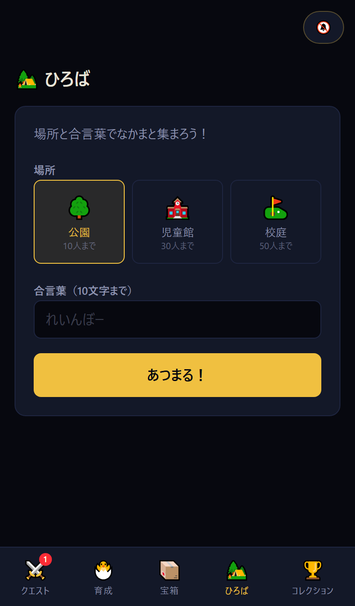
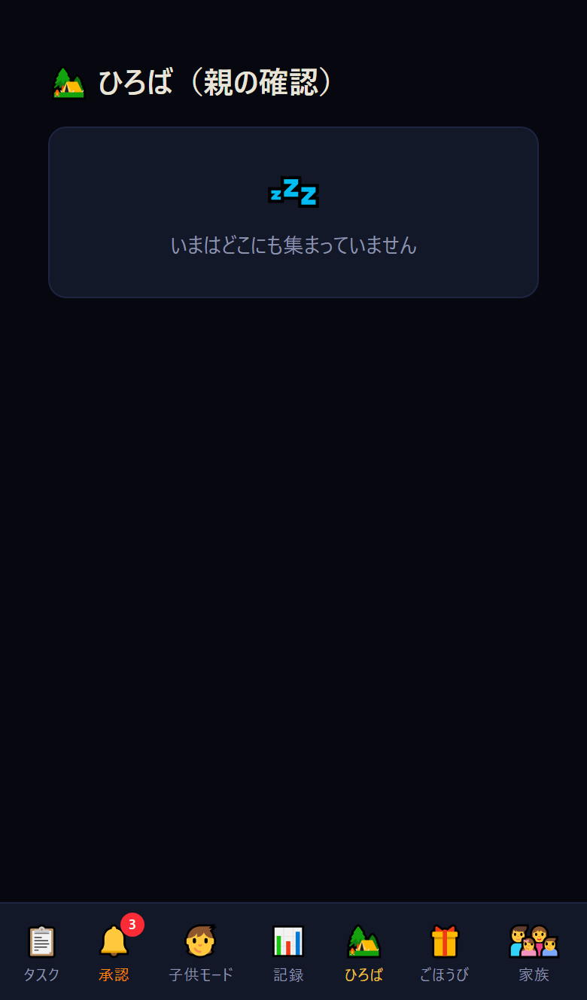

# ひろば

ひろばは、子どもが友だちと「場所」と「合言葉」を決めて集まり、おたがいのがんばりを見たり、エールを送り合ったりする機能です。別の家族の子どもとも、同じ場所・同じ合言葉を入れれば同じグループになります。

この章では、ひろばへの参加と退出、掲示板とエールのしくみ、ひろばでほかの人に見える情報を説明します。

---

## 1. 全体の流れ

```
子どもが ひろば 画面で「場所」と「合言葉」を入れて「あつまる！」
  → 同じ場所・同じ合言葉を入れた子どもと同じグループになる
  → グループのなかま一覧と掲示板が見られる
  → クエストを進めると、掲示板に自動でログが流れる
  → 1日1回「みんなにエールを送る」で、なかまを応援できる
  → やめたいときは「ぬける」
```

ひろばへの参加・退出・エールの送信は **子どもの画面からだけ** できます。おうちの人は内容を見ることだけができます。

---

## 2. ひろばに参加する（子どもの画面）

子どもの **🏕️ ひろば** 画面で操作します。

1. 「場所」を選びます。

   | 場所 | 定員 |
   |---|---|
   | 🌳 公園 | 10人まで |
   | 🏫 児童館 | 30人まで |
   | ⛳ 校庭 | 50人まで |

2. 「合言葉（10文字まで）」を入力します。
3. **あつまる！** を押します。

▼ 子どものひろば画面（参加前）



### 合言葉のルール
- 同じ **場所** で同じ **合言葉** を入れた子どもが、同じグループになります。場所が違えば、合言葉が同じでも別のグループです。
- ひらがなはカタカナに、英字は大文字にそろえて扱います。たとえば「れいんぼー」「レインボー」は同じ合言葉です。入力欄の下に「正規化後:」として、実際に使われる合言葉が表示されます。
- 前後の空白は無視されます。11文字目以降は切り捨てられます。

### 参加できないとき

| 表示 | 理由 |
|---|---|
| 合言葉を入れてね | 合言葉が空 |
| このグループは満員です | その場所の定員に達している |
| すでにグループに参加しています | 別のグループに参加中。先に「ぬける」で抜ける |

- 1人の子どもが参加できるグループは **1つだけ** です。

---

## 3. 参加中の画面

参加すると、ひろば画面に次のものが表示されます。

### グループ情報
場所、合言葉、「〇/定員 人 あつまっている」の人数。

### 👥 なかま
グループに参加している子どものモンスターが並びます。

- 表示されるのは **モンスターの名前**（子どもを追加するときに付けた名前）と **モンスターの種類** です。
- 自分のモンスターは金色の枠で表示されます。
- モンスターを押すと大きく表示されます。

### 掲示板
なかまのがんばりが、自動でログとして流れます。子どもやおうちの人が文章を書き込むことはできません。

| 絵文字 | 流れるタイミング | 表示例 |
|---|---|---|
| 🚀 | その日のクエストを1つ終えた | 〇〇が今日のクエストをスタートした！ |
| 🌱 | 25% 以上終えた | 〇〇はクエストを頑張っている！ |
| 💪 | 50% 以上終えた | 〇〇は夢中でクエストをこなしている！ |
| ⚡ | 75% 以上終えた | 〇〇のクエストはもうすぐ全部終わりそうだ！ |
| 🎉 | 全部終えた | 〇〇は今日のクエストをすべてやりとげた！ |
| 🏅 | バッジを手に入れた | 〇〇は新しいバッジ「…」を手に入れた！ |
| 👑 | 連続達成の称号を手に入れた | 〇〇は新しい称号「…」を手に入れた！ |
| 🌟 | モンスターが進化した | 〇〇のモンスターが…に進化した！ |
| 🐣 | モンスターが転生した | 〇〇のモンスターが転生して…の卵になった！ |
| 📣 | エールを送った | 〇〇がみんなにエールを送ったよ！ |
| 🎴 | 宝箱でコレクションアイテムを手に入れた | 〇〇は夏の★★コレクション「…」を手に入れた！ |

- 〇〇にはモンスターの名前が入ります。
- クエストの進み具合は、子どもが **報告した時点** で流れます（親の承認を待ちません）。スキップや子供モードでの代理報告も「終えた」に数えます。
- バッジ・称号・進化は、親が承認したときに流れます。
- 掲示板には **直近4日分**（今日と、その前の3日）が日付ごとに「M/D（曜）の掲示板」としてまとめて表示されます（最大200件）。
- 同じ子どもの同じ日のクエスト進み具合は、最新の1件だけが表示されます。
- 同じ子どもの同じ種類のログが5分以内に続いたときは、1つにまとめて「×件数」と表示されます。
- 新しいログは画面を開いたまま自動で追加されます。
- グループに参加していない間のがんばりは、掲示板に流れません。

---

## 4. エールを送る

参加中のひろば画面にある **📣 みんなにエールを送る** を押すと、グループのなかま全員にエールが届きます。

- **1日1回** だけ送れます。送った後は「今日のエールは送信ずみ」になります。
- 送ると、掲示板に「〇〇がみんなにエールを送ったよ！」と流れます。

### エールが届いたとき
受け取った子どものクエストの進み具合によって、メッセージが変わります。

| 受け取った子どもの今日の状態 | メッセージ |
|---|---|
| まだ1つも終えていない | 〇〇からエール！スタートのきっかけにしよう！ |
| 途中まで終えた | 〇〇からエール！その調子、いっしょに頑張ろう！ |
| 全部終えた | 〇〇からエール！今日のがんばり、最高だね！ |

- 通知を許可している端末には、「エールが届いたよ！」という通知が届きます。通知を押すとひろばが開きます。
- 今日のクエストを **全部終えている子ども** には、通知は送られません（ひろばを開いたときに表示されます）。
- ひろばを開くと、その日に届いたまだ見ていないエールが全画面で表示されます。複数人から届いたときは「〇〇・〇〇・ほか〇人からエール！」のようにまとめて表示されます。
- メッセージにタスク名や数字は含まれません。

---

## 5. ひろばから抜ける（子どもの画面）

参加中の画面の **ぬける** を押すと、すぐにグループから抜けます（確認画面は出ません）。

- 抜けた後は、また別の場所・合言葉で参加できます。同じ場所・合言葉を入れれば、元のグループに戻れます。
- おうちの人の画面や子供モードからは、子どもを抜けさせることはできません。

---

## 6. おうちの人の画面で見る

親のナビの **🏕️ ひろば** で、子どもが参加しているひろばを見られます。画面のタイトルは「ひろば（親の確認）」です。

- 子どもが2人以上いるときは、上部で子どもを選びます。
- 見られるもの: 場所、合言葉、人数、なかま一覧、掲示板（子どもの画面と同じ内容）
- 子どもがどこにも参加していないときは「いまはどこにも集まっていません」と表示されます。
- エールを送る、参加する、抜ける、の操作はできません。

子供モードの **🏕️ ひろば** でも同じ内容を見られます（[子供モード](child-view.md) を参照）。

▼ おうちの人のひろば画面（どこにも参加していないとき）



---

## 7. ひろばで見える情報・見えない情報

ひろばでは、**別の家族の子どもとも同じグループになることがあります**。合言葉を知っていれば誰でも参加できるため、ほかの人に何が見えるかを確認してください。

| 情報 | ほかのなかま（別の家族を含む）に見えるか |
|---|---|
| モンスターの名前 | 見える |
| モンスターの種類・画像・進化の段階 | 見える |
| 子どもの本名 | 見えない（ひろばでは使われません） |
| クエストを始めた・25%/50%/75%・全部終えた | 見える（掲示板） |
| タスクの名前・内容・件数 | 見えない |
| 手に入れたバッジ・称号・コレクションアイテムの名前 | 見える（掲示板） |
| 進化・転生 | 見える（掲示板） |
| エールを送ったこと | 見える（掲示板） |
| 写真・コメント | 見えない |
| ごほうびの内容 | 見えない |
| 家族の情報・おうちの人の情報 | 見えない |

- **モンスターの名前に本名を付けると、ひろばで本名が見えてしまいます。** 子どもを追加するときは、本名ではないニックネームを付けることをおすすめします。
- 知らない人と同じグループにならないよう、合言葉は友だち同士だけで決めた、ほかの人が思いつかないものにしてください。
- ひろばでは、文章のやりとりやメッセージの送信はできません。

---

## よくある質問

**Q. 友だちと同じ合言葉を入れたのに、別のグループになった**
場所が違う可能性があります。同じ場所を選んでいるか確認してください。

**Q. 「すでにグループに参加しています」と出て参加できない**
子どもは1つのグループにしか参加できません。今のグループで「ぬける」を押してから参加し直してください。

**Q. 掲示板に古いログが出ない**
掲示板に出るのは直近4日分だけです。

**Q. エールの通知が届かない**
通知を許可していない端末には届きません。また、受け取る子どもが今日のクエストを全部終えている場合は、通知は送られず、ひろばを開いたときに表示されます。

**Q. 親が子どもの代わりにエールを送ったり、ひろばから抜けさせたりできる？**
できません。参加・退出・エールは子どもの画面からだけ操作できます。

**Q. 知らない子どもがグループにいる**
同じ場所・同じ合言葉を入れれば、どの家族の子どもでも同じグループになります。子どもの画面で「ぬける」を押し、別の合言葉で参加し直してください。
