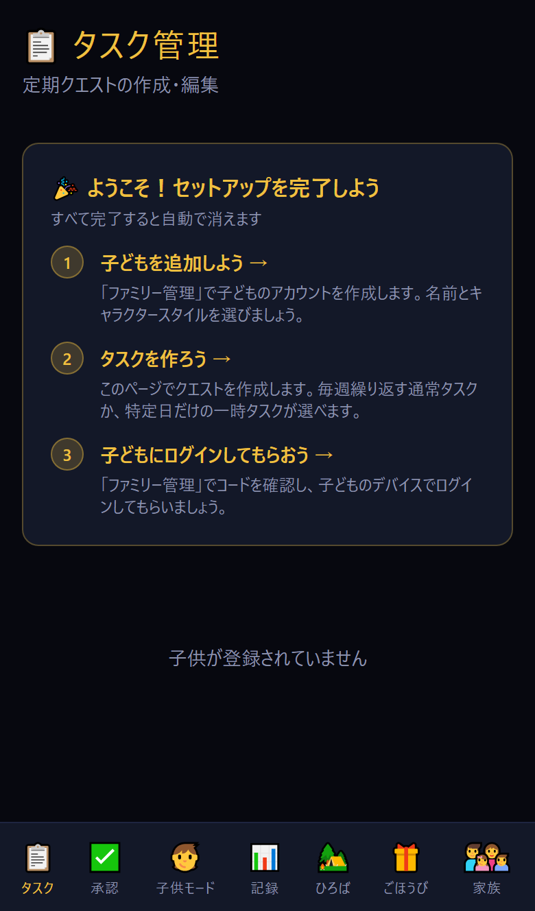
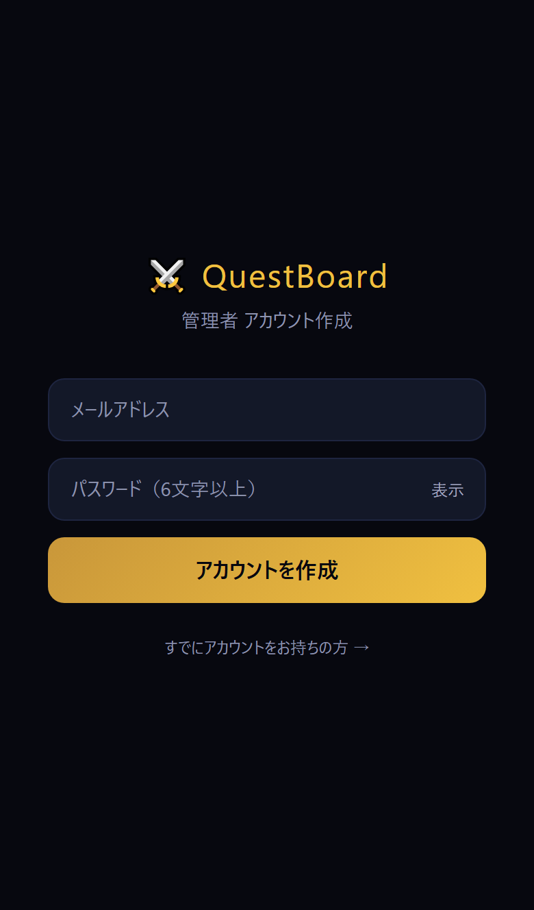
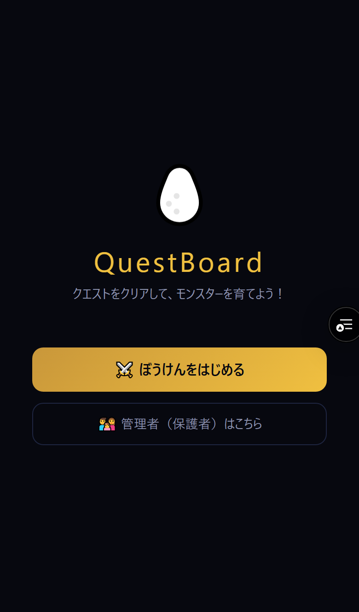
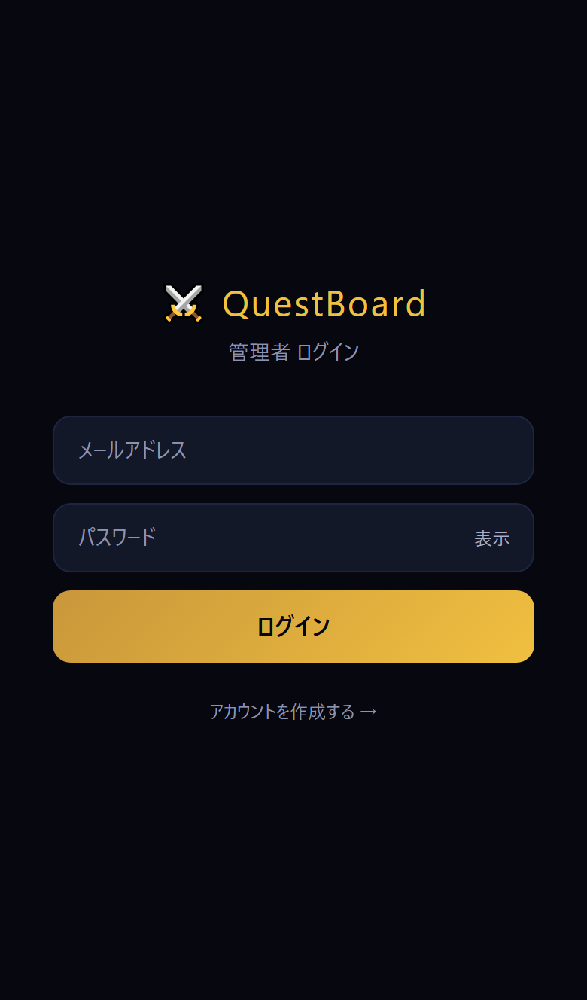
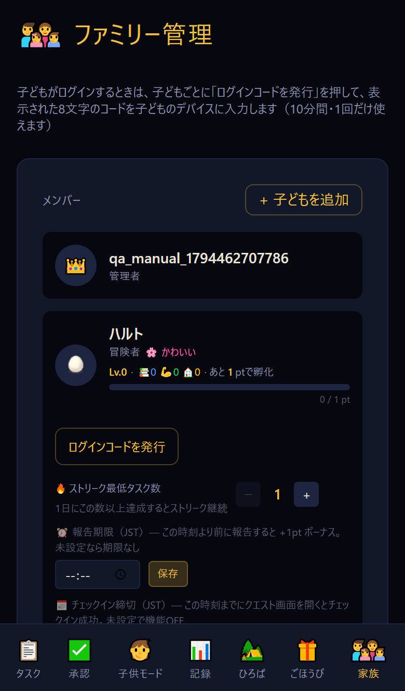
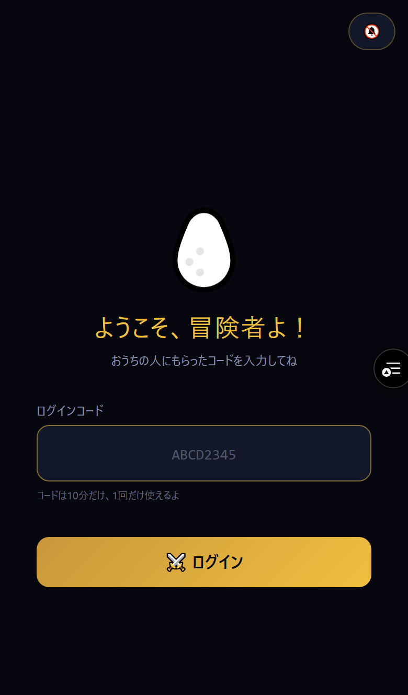
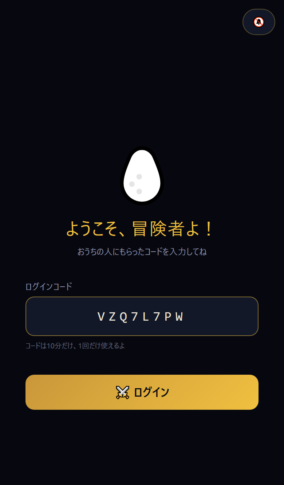

# はじめに

QuestBoard は、おうちの人が出したタスク（クエスト）を子どもがこなし、そのごほうびとしてモンスターを育てるアプリです。

この章では、アカウントの作成から、子どもが最初のクエストを始めるまでの準備を説明します。

---

## 1. QuestBoard でできること

```
おうちの人がタスクを作る
  → 子どもが自分の端末でクエストを見る
  → 終わったら「報告」する（できない日は「スキップ」を申請）
  → おうちの人が承認する
  → 子どもに XP（ポイント）が入り、モンスターが育つ・進化する
  → 条件を満たすと宝箱がもらえ、ごほうびやコレクションが出る
```

- おうちの人は「管理者」、子どもは「冒険者」として表示されます。
- おうちの人と子どもは、それぞれ自分の端末からログインします。
- 子どもの端末がないときは、おうちの人の画面から「子供モード」で代わりに操作できます。

---

## 2. 最初にやること（セットアップ）

アカウントを作ると、**📋 タスク管理** 画面の上に「🎉 ようこそ！セットアップを完了しよう」という案内が出ます。次の 3 ステップが終わると、案内は自動で消えます。

| ステップ | やること | 画面 |
|---|---|---|
| 1 | 子どもを追加しよう | ファミリー管理 |
| 2 | タスクを作ろう | タスク管理 |
| 3 | 子どもにログインしてもらおう | ファミリー管理（ログインコードを発行） |

以下、順番に説明します。

▼ 登録した直後のタスク画面（セットアップの案内）



---

## 3. アカウントを作る（おうちの人）

1. ログイン選択画面（`/login`）で「👨‍👩‍👧 管理者（保護者）はこちら」を押します。
2. 「アカウントを作成する →」を押します。
3. 「管理者 アカウント作成」画面で、メールアドレスとパスワード（6文字以上）を入力します。
   - パスワード欄の「表示」を押すと、入力した文字を確認できます。
4. 「アカウントを作成」を押します。

作成が終わると、そのまま **📋 タスク管理** 画面が開きます。アカウントを作ると、新しい家族が 1 つ作られ、あなたがその家族の管理者になります。

▼ アカウント作成画面



---

## 4. ログインする（おうちの人）

1. ログイン選択画面で「👨‍👩‍👧 管理者（保護者）はこちら」を押します。
2. 「管理者 ログイン」画面で、メールアドレスとパスワードを入力し、「ログイン」を押します。
3. **📋 タスク管理** 画面が開きます。

- すでにログインしている状態でログイン選択画面を開くと、自動でホーム画面（親は タスク管理、子どもは クエスト）に移ります。
- 「アカウントが見つかりません。新規登録からやり直してください」と出た場合は、そのアカウントは削除済みです。新しくアカウントを作ってください。

▼ ログイン選択画面（/login）



▼ おうちの人のログイン画面



### ログアウト
**👨‍👩‍👧‍👦 ファミリー** 画面のいちばん下にある「🚪 ログアウト」を押します。

---

## 5. 子どもを追加する

1. **👨‍👩‍👧‍👦 ファミリー** 画面を開きます。
2. 「メンバー」の右にある「+ 子どもを追加」を押します。
3. 「新しい冒険者を追加」に入力します。

   | 項目 | 内容 |
   |---|---|
   | なまえ | 子どもの名前（20文字まで。例: りゅうくん）。アプリ内ではこの名前で表示されます |
   | スタイル | 育てるモンスターの見た目。「🌸 かわいい」か「🌑 かっこいい」 |
   | テーマ | 有料のモンスターテーマを持っている場合だけ表示されます。「スタイルに合わせる」を選ぶとスタイルどおりになります |

4. 「追加」を押します。

- 無料プランで追加できる子どもは 1 人までです。上限を超えると「無料プランでは子アカウントは1人までです。プレミアムプランで無制限になります。」と表示され、「プラン管理を見る」から プラン画面に移れます。
- 追加した子どもは、まだ端末からはログインしていない状態です。次の「6. 子どもの端末でログインする」に進んでください。
- 子どもごとの細かい設定は [ファミリー設定とプラン](family-and-plan.md) を参照してください。

▼ ファミリー管理画面（子どもを追加した直後）



---

## 6. 子どもの端末でログインする

子どもはメールアドレスやパスワードを使いません。おうちの人が発行する **ログインコード** でログインします。

### おうちの人がやること
1. **👨‍👩‍👧‍👦 ファミリー** 画面で、ログインさせたい子どものカードにある「ログインコードを発行」を押します。
2. 8 文字のコード（例: `ABCD2345`）と「残り 9:59（1回だけ使えます）」のような残り時間が表示されます。
3. このコードを子どもの端末に入力してもらいます。

### 子どもの端末でやること
1. ログイン選択画面で「⚔ ぼうけんをはじめる」を押します。
2. 「ようこそ、冒険者よ！」画面の「ログインコード」にコードを入力します。
3. 「⚔ ログイン」を押すと、子どもの **クエスト** 画面が開きます。

▼ 子どものログイン画面



▼ ログインコードを入力したところ



### ログインコードの決まり
- コードは **発行から 10 分間** だけ有効です。期限が切れると「有効期限が切れました。もう一度発行してください」と表示されます。
- コードは **1 回だけ** 使えます。使ったコードはもう使えません。
- 「ログインコードを再発行」を押すと新しいコードが出ます。前のコードは使えなくなります（有効なコードは子ども 1 人につき 1 つだけです）。
- 大文字・小文字、全角・半角は区別しません。空白やハイフンが混ざっていても自動で取り除かれます。
- 紛らわしい文字（`0` と `O`、`1` と `I` など）はコードに使われません。
- 子どもがコードでログインすると、おうちの人に「ログインコードが使われました」という通知が届きます（通知を有効にしている場合）。

### 別の端末でログインし直したとき
新しい端末でログインすると、それまで使っていた端末の子ども画面は使えなくなり、子どものログイン画面に戻ります。端末を替えたときや、ログアウトしてしまったときは、もう一度コードを発行してください。

### 同じ端末でおうちの人と子どもが使うとき
1 つのブラウザでは、おうちの人と子どもが同時にログインしていられません。子どもがログインすると、そのブラウザのおうちの人はログアウトされます。おうちの人の画面を使うときは、もう一度ログインしてください。

子どもの端末がない場合は、おうちの人の画面の **🧒 子供モード** で子どもの画面を代わりに操作できます。

### 子どものログアウト
子どもの **育成** 画面の下にある「🚪 ログアウト」を押します。「ログアウトするとさいしょの画面にもどるよ。本当にログアウトする？」と確認が出ます。

---

## 7. ホーム画面に追加する

QuestBoard はアプリストアからではなく、ブラウザから使います。ホーム画面に追加すると、普通のアプリのようにアイコンから開けます。通知を受け取るためにも、ホーム画面への追加をおすすめします。

### iPhone・iPad（Safari）
1. Safari で QuestBoard を開くと、画面の下に「ホーム画面に追加してアプリとして使えます」という案内が出ます。
2. 画面内の共有ボタンを押し、「ホーム画面に追加」を選びます（見つからない場合は「もっと見る」を押します）。

- 案内は「×」で閉じられます。閉じると、その端末では次から表示されません。
- ホーム画面から開いているときは、案内は表示されません。

### Android など（Chrome）
ログイン選択画面に「📲 ホーム画面に追加する」ボタンが出たら、押して追加します。

- ブラウザが対応していない場合や、すでに追加済みの場合はボタンが出ません。その場合はブラウザのメニューから「ホーム画面に追加」を選んでください。

---

## 8. 通知を受け取る

通知を有効にすると、子どもの報告や申請がすぐにわかります。

### 有効にする方法
- **おうちの人**: ナビの「🔔 通知を有効にする」を押し、ブラウザの確認で「許可」を選びます。
- **子ども**: 画面右上の「🔔 通知を有効にする」を押し、「許可」を選びます。

- ボタンは、まだ許可も拒否もしていないときだけ表示されます。許可した後は表示されません。
- 子どもの画面で通知を拒否していると「🔕 通知オフ」と表示されます。押すと、ブラウザの設定で通知を「許可」に変える方法が表示されます。
- iPhone・iPad では、ホーム画面に追加したアプリから開かないと通知を受け取れない場合があります。

### おうちの人に届く通知

| 通知 | 届くとき |
|---|---|
| ✅ クエスト報告 | 子どもがクエストを報告したとき |
| 😴 スキップ申請 | 子どもがスキップを申請したとき |
| 📋 タスク申請 | 子どもがタスクを申請したとき |
| 🎁 ごほうびゲット！ | 子どもが宝箱からごほうびを引き当てたとき |
| 🎁 ごほうび使用申請 | 子どもがごほうびの「つかう」を申請したとき |
| ログインコードが使われました | 子どもがログインコードでログインしたとき |

### 子どもに届く通知

| 通知 | 届くとき |
|---|---|
| ⏰ クエストタイム | 毎日 17:00 に、その日のクエストが終わっていないとき（ファミリー設定でオフにできます） |
| ⏰ リマインド | おうちの人がリマインドを送ったとき |
| エールが届いたよ！ | ひろばで仲間からエールが届いたとき |

---

## 9. 親の画面の見方（ナビ）

パソコンや幅の広い画面では左側に、スマホでは画面下にナビが表示されます。

| ナビ（パソコン） | ナビ（スマホ） | 画面でできること |
|---|---|---|
| 📋 タスク管理 | 📋 タスク | タスク（クエスト）の作成・編集・一時停止・削除、テンプレートからの追加 |
| ✅ 承認 | ✅ 承認 | 子どもの報告・スキップ申請・ごほうび使用申請の承認と差し戻し（承認センター） |
| 🧒 子供モード | 🧒 子供モード | 子どもの画面を開いて、代わりに報告・スキップ・宝箱の開封などをする |
| 📊 記録 | 📊 記録 | 「🏆 今日」の達成状況と「📅 過去」の履歴 |
| 🏕️ ひろば | 🏕️ ひろば | 子どもが参加しているひろば（仲間との交流）の様子を確認する |
| 🎁 ごほうび | 🎁 ごほうび | 宝箱から出るごほうびの設定と、もらったごほうびの履歴 |
| 👨‍👩‍👧‍👦 ファミリー | 👨‍👩‍👧‍👦 家族 | 子どもの追加・設定・削除、ログインコードの発行、ログアウト、アカウント削除 |
| 💳 プラン | （なし） | 現在のプランと利用状況 |

### 件数バッジ
- **承認** には、承認待ちの件数（報告・スキップ申請・ごほうび使用申請の合計）が赤い数字で表示されます。
- **タスク** には、子どもから申請されたタスクの件数が表示されます。
- スマホでは、件数があるとアイコンが 🔔 に変わります。100 件以上は「99+」と表示されます。

### スマホでプラン画面を開くには
スマホのナビには プラン がありません。上限に達したときに出る「プラン管理を見る」などのリンクから開けます。

---

## よくある質問

**Q. 子どもがログインコードを入れても「コードが正しくありません」と出る**
コードの期限（10分）が切れているか、すでに使われているか、再発行で古いコードになっている可能性があります。ファミリー画面で「ログインコードを再発行」を押し、新しいコードを入力してください。

**Q. 「試行回数が多すぎます。しばらくしてからもう一度お試しください」と出た**
間違ったコードを続けて入力すると、しばらくログインできなくなります（同じ端末で 5 回続けて間違えると 15 分間）。時間をおいて、新しく発行したコードで試してください。

**Q. 子どもの端末でログインしたら、おうちの人の画面からログアウトされた**
1 つのブラウザでは、おうちの人と子どもが同時にログインできません。おうちの人の画面を使うときは、もう一度ログインしてください。

**Q. 前に使っていた子どもの端末がログイン画面に戻った**
別の端末で同じ子どもがログインすると、前の端末は使えなくなります。前の端末で使い続けたい場合は、その端末でもう一度コードを入力してください（その場合は、もう一方の端末が使えなくなります）。

**Q. 通知が届かない**
「🔔 通知を有効にする」から通知を許可しているか確認してください。iPhone・iPad では、ホーム画面に追加したアプリから開いて許可してください。ブラウザで一度「拒否」した場合は、ブラウザの設定で通知を「許可」に変える必要があります。

**Q. 「📲 ホーム画面に追加する」ボタンが出ない**
iPhone・iPad では表示されません。Safari の共有ボタンから「ホーム画面に追加」を選んでください。Android でも、すでに追加済みの場合やブラウザが対応していない場合は表示されません。
