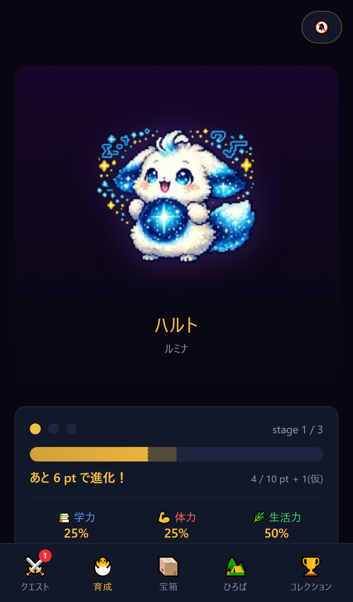
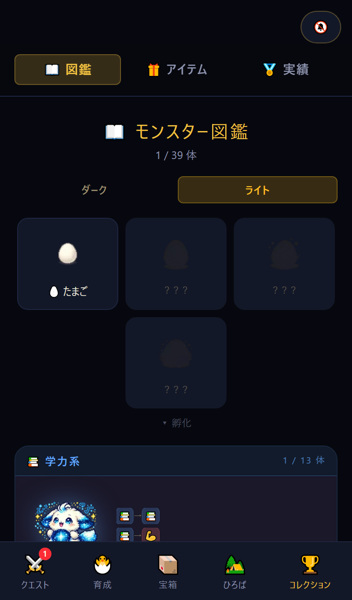

# モンスターの育成（ポイント・進化・転生）

子どもがクエストをクリアしておうちの人が承認すると、ポイント（pt）がもらえます。ポイントがたまると、たまごがかえり、モンスターが進化していきます。最終形態でさらにポイントをためると「転生」して、またたまごから育て直せます。

この章では、ポイントのもらい方、進化の仕組み、転生、モンスターテーマの変え方を説明します。

---

## 1. 全体の流れ

```
クエストを承認する → ポイントがたまる
  → たまご が孵化（第1形態）
  → 進化（第2形態）
  → 進化（第3形態 = 最終形態）
  → 最終形態で 20pt ためる → 「転生の準備ができた！」
  → 子どもが卵を選んで転生 → たまご に戻る（図鑑の記録は残る）
  → くりかえし
```

▼ 子どもの育成画面



---

## 2. ポイントの種類

ポイントはタスクのカテゴリごとに3種類あります。どのカテゴリでためたかによって、進化先が変わります。

| カテゴリ | 表示 | 例 |
|---|---|---|
| 学力 | 📚 学力 | 宿題、音読、読書 |
| 体力 | 💪 体力 | 外遊び、縄跳び、ストレッチ |
| 生活力 | 🌿 生活力 | 片付け、歯磨き、お手伝い |

- カテゴリはタスクを作るときに選びます。
- 子どもの **育成** 画面には、カテゴリごとのポイントと「合計ポイント」が表示されます。

---

## 3. 1回のクエストでもらえるポイント

| 内容 | ポイント |
|---|---|
| クエストを承認された | 1pt |
| 報告期限より前に報告した | +1pt |
| 写真ボーナスありのタスクに写真を付けて報告した | +1pt |
| 「今日やる」宣言をした日に報告した | +1pt |

- 1回の最大は 4pt です。
- **ポイントが入るのは、おうちの人が承認したときです。** 報告しただけでは入りません。承認待ちの分は、育成画面で「+ ○ pt(仮)」と薄く表示されます。
- スキップを承認しても、ポイントは入りません。
- 報告期限は **ファミリー設定 → 子どものカード → ⏰ 報告期限（JST）** で子どもごとに設定します。未設定なら期限ボーナスはありません。
- 写真ボーナスはタスクごとの設定です（タスク作成の章を参照）。

### 「今日やる」宣言
しばらく手つかずのタスクには、クエスト画面に「「今日やる」って決めると、完了したときボーナスがもらえる」というボタンが出ます。

- ボタンが出るのは、そのタスクが **3回続けて承認されていない** ときです（スキップも「承認されていない」に数えます）。
- 宣言すると「✓ 宣言済み」になり、その日に報告して承認されると +1pt です。

### クエスト以外でもらえるポイント
| 内容 | ポイント | 入るカテゴリ |
|---|---|---|
| ストリークの称号を獲得 | 5〜30pt | 3カテゴリに均等に分ける |
| ログインボーナス（10日連続ごと） | 1pt | いちばん少ないカテゴリ |

詳しくは「ストリーク・実績・コレクション」の章を見てください。

---

## 4. 進化の段階と必要なポイント

| 今の段階 | 次の段階 | 必要なポイント（3カテゴリの合計） |
|---|---|---|
| たまご（はじめて） | 第1形態 | 1pt |
| たまご（転生後） | 第1形態 | 5pt |
| 第1形態 | 第2形態 | 10pt |
| 第2形態 | 第3形態（最終形態） | 30pt |
| 第3形態（最終形態） | 転生 | 20pt |

- 育成画面には「あと ○ pt で孵化／進化／転生！」と表示されます。
- **進化するとポイントは 0 に戻ります。** 進化に必要な分を超えた余りは、次の段階に持ち越されません。
  - 例: 第1形態で 9pt → 3pt のクエストが承認されて 12pt → 進化して 0pt から再スタート
- 最終形態では、20pt たまっても自動では転生しません（[6. 転生](#6-転生) を参照）。

---

## 5. 進化先の決まり方

モンスターは段階ごとに3方向（📚 学力系・💪 体力系・🌿 生活力系）に分かれます。孵化のときも、進化のときも、そのつど抽選で1つに決まります。

- 3段階 × 3方向で、1つのテーマに **39体**（第1形態 3体・第2形態 9体・第3形態 27体）います。
- 抽選の確率は、**その段階でためたポイントの割合** で決まります。育成画面の進化ゲージの下に、カテゴリごとの確率（%）が表示されます。

### 確率のルール
1. いちばん多いカテゴリの確率は、ポイントの割合と同じです。ただし **最大 60%** です。
2. 残りを、2番目と3番目のカテゴリでポイントの比で分けます。
3. どのカテゴリも **最低 15%** はあります。まったくやっていないカテゴリにも進化する可能性があります。

| その段階でためたポイント | 📚 学力 | 💪 体力 | 🌿 生活力 |
|---|---|---|---|
| どれも 0pt | 33% | 33% | 33% |
| 学力 5 / 体力 2 / 生活力 0 | 約 50% | 約 35% | 15% |
| 学力 30 / 体力 0 / 生活力 0 | 60% | 20% | 20% |

### 卵ボーナス
転生のときに選んだ卵によって、そのカテゴリの確率が **+20%** されます（他の2つはその分だけ下がります）。

- 例: 33% / 33% / 33% のときに「勉強の卵」を選んでいる → 53% / 23% / 23%
- ボーナスは **次に転生するまで** の孵化・進化すべてに効きます。

---

## 6. 転生

最終形態で 20pt ためると、育成画面に「✨ 転生の準備ができた！」と「✨ 転生する！」ボタンが出ます。子どもの画面のナビ（🐣 育成）にもバッジが付きます。

### 子どもが転生する
1. 「✨ 転生する！」を押すと「卵を選ぼう」が開きます。
2. 卵を1つ選びます。

   | 卵 | 効果 |
   |---|---|
   | ふつうの卵 | ボーナスなし |
   | 勉強の卵 | 📚 学力の確率+20% |
   | 体力の卵 | 💪 体力の確率+20% |
   | 生活力の卵 | 🌿 生活力の確率+20% |

3. 「転生！」の演出が出て、選んだ卵に戻ります。

- 「キャンセル（後でする）」で、転生を後回しにできます。
- 同じ卵を何度選んでもかまいません。
- 転生すると、ポイント・進化の段階は 0 に戻ります。**図鑑の記録・実績・転生回数は残ります。**

### 転生を後回しにしているあいだ
- クエストのポイントは加算され続けますが、**進化はしません**。転生したときに 0 に戻ります。
- 親の **子供モード → 育成** 画面には「転生待ちです」と表示されます。

### 親が代わりに転生する
子供モードの育成画面で「🥚 代理で転生する（NORMAL 卵）」を押すと、親が代わりに転生できます。

- 代理転生は **ふつうの卵（ボーナスなし）** だけです。勉強・体力・生活力の卵を選ばせたいときは、子どもの画面から操作してください。
- 子供モードの育成画面は見るだけです。代理転生以外の操作はできません。

---

## 7. 演出（カットイン）

| タイミング | 表示 |
|---|---|
| たまごが孵化した | うまれた！ |
| 進化した | 進化した！ |
| 転生した | 転生！ 新たな冒険がはじまる… |
| ストリークの称号を獲得した | 称号を獲得！ ＋○pt ゲット！ |

- 孵化・進化の演出は、子どもがアプリを開いていればどの画面でもすぐに表示されます。閉じていた場合は、次にアプリを開いたときに表示されます。
- 進化や転生は「ひろば」の掲示板にも流れます。

---

## 8. モンスターテーマ

モンスターの見た目のセットを「テーマ」と呼びます。

| テーマ | 内容 | 料金 |
|---|---|---|
| ダーク | かっこいい系 | 無料 |
| ライト | かわいい系 | 無料 |
| 仏様 | 仏様・神様モチーフ | 有料 |
| 妖怪 | 日本の妖怪モチーフ | 有料 |
| 電車 | 日本の鉄道モチーフ | 有料 |

### 子どもを追加するとき
**ファミリー設定 → 子どもを追加** で「🌸 かわいい（ライト）」か「🌑 かっこいい（ダーク）」を選びます。有料テーマを持っている場合は「テーマ」欄から選べます。

### あとから変える
**ファミリー設定 → 子どものカード → 🎨 モンスターテーマ** で変えられます。

- 子どもが **たまご** のとき、または **転生待ち** のときは、すぐに変わります（「テーマを変更しました」）。
- 育成の途中（第1〜第3形態）のときは、見た目が急に変わらないよう **次の転生から** 変わります（「次の転生からこのテーマになります」）。予約中は「いまのテーマ: ○○ / 次回: ○○」と表示されます。
- 持っていない有料テーマは「(準備中)」と表示され、選べません。
- 有料テーマは家族単位で持ちます。兄弟がいれば全員が使えます。

---

## 9. 図鑑

子どもの **コレクション → 📖 図鑑** で、これまでに出会ったモンスターを見られます。

- 「○ / 39 体」で、今のテーマで集めた数が表示されます。
- 一度でも孵化・進化させたモンスターが記録されます。まだのモンスターは「？？？」です。
- 有料テーマを持っている場合は、テーマごとのタブで切り替えます。図鑑はテーマごとに別々に記録されます。
- いちばん上には卵が並びます。勉強・体力・生活力の卵は、転生で一度選ぶと表示されます。
- 最終形態のモンスターには **Lv** が付きます。そのモンスターに進化した回数がレベルになり、レベルが上がるほど背景のオーラが強くなります（Lv5 まで変化します）。
- 最終形態のモンスターの説明文は **Lv3** になると読めます。それまでは「Lv3になると せつめいが よめるよ！」と表示されます（第1・第2形態は、出会えばすぐ読めます）。

▼ 子どものモンスター図鑑



---

## よくある質問

**Q. クエストをクリアしたのにポイントが増えない**
まだ承認していません。承認待ちの分は「(仮)」として表示されています。承認センターで承認してください。

**Q. 進化したらポイントが 0 になった**
仕様です。進化するたびにポイントは 0 から数え直します。

**Q. 勉強ばかりしているのに体力系に進化した**
どのカテゴリにも最低 15% の確率があります。いちばん多いカテゴリでも最大 60% です。特定の系統に進化させたいときは、転生時にその系統の卵を選ぶと確率が +20% されます。

**Q. ポイントがたまっているのに進化しない**
最終形態で「転生待ち」になっていると、進化しません。子どもの画面で転生するか、子供モードから代理で転生してください。

**Q. 転生したらモンスターがいなくなった**
転生するとたまごからやり直しです。これまで育てたモンスターは図鑑に残っています。

**Q. テーマを変えたのに見た目が変わらない**
育成の途中は、次の転生まで変わりません。ファミリー設定の「次回: ○○」で予約されているか確認してください。
