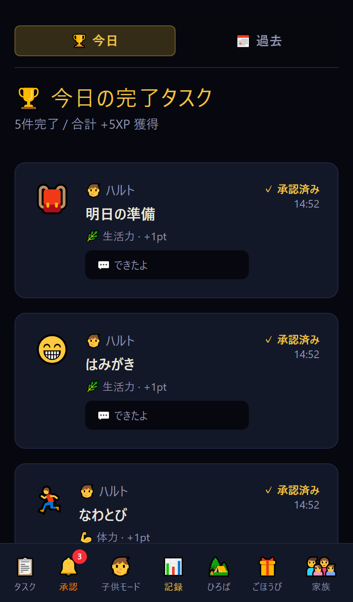
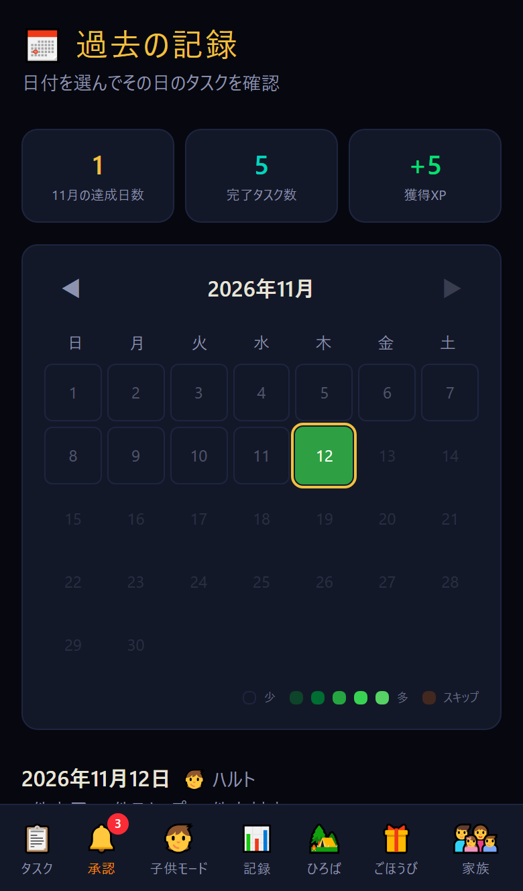

# 記録・履歴

**記録** 画面では、今日終わったタスクと、過去の日ごとの達成状況を見られます。

この章では、記録画面の2つのタブ（🏆 今日 / 📅 過去）で見られるものと、各表示の意味を説明します。

---

## 1. 記録画面の開き方

ナビの **📊 記録** から開きます。画面上部のタブで切り替えます。

| タブ | 見られるもの |
|---|---|
| 🏆 今日 | 今日報告されて、承認・スキップが確定したタスクの一覧 |
| 📅 過去 | カレンダーで日付を選んで、その日のタスクの結果を見る。月ごとの集計も出る |

> 承認待ちのタスクは記録画面には出ません。承認待ちは [承認センター](approve.md) で確認してください。

▼ 記録画面（🏆 今日）

---

## 2. 🏆 今日（今日の完了タスク）

### 画面上部の集計
「〇件完了 · 〇件スキップ / 合計 +〇XP 獲得」と出ます。

- **〇件完了**: 承認したタスクの数
- **〇件スキップ**: スキップを承認したタスクの数（0件のときは表示されません）
- 何もないときは「今日はまだ完了したタスクがありません」と出ます。

### 一覧に出るタスク
- **今日報告されたタスク** のうち、承認済み・スキップ済みのものが出ます。
- 子ども全員の分が1つの一覧にまとまります。報告が新しいものが上です。
- 昨日報告されて今日承認したタスクは、ここには出ません。「📅 過去」でその日を選ぶと見られます。

### カードの見方
| 項目 | 内容 |
|---|---|
| 🧒 〇〇 | どの子どものタスクか |
| タスク名 | |
| 📚 学力 / 💪 体力 / 🌿 生活力 · +〇pt | カテゴリと、入った XP（承認済みのみ） |
| 写真 | 写真付きで報告された場合に表示。タップすると大きく表示されます |
| 💬 コメント | 子どもが書いたコメント（スキップの場合はスキップの理由） |
| ✓ 承認済み / ⏭ スキップ と時刻 | 結果と、承認した時刻。スキップのカードはオレンジの枠です |

### 一時タスクを別の日に送る
スキップした **一時タスク**（その日だけのタスク）のカードには、日付の欄と **📅 次の日に送る** ボタンが出ます。

1. 送り先の日付を選びます（初期値は翌日。今日以前は選べません）。
2. **📅 次の日に送る** を押します。
3. 「✓ 翌日に送りました」と出れば完了です。選んだ日に同じタスクが作られます。

- 無料プランでタスクの上限に達している場合は送れません。上限の案内が出ます。

---

## 3. 📅 過去（過去の記録）

「日付を選んでその日のタスクを確認」する画面です。

### 子どもを選ぶ
子どもが2人以上いる場合は、画面上部で子どもを選びます。集計・カレンダー・一覧は、選んだ子どもの分だけが出ます。子どもが1人の場合は選ぶ必要はありません。

### 月の集計
カレンダーで表示している月について、3つの数字が出ます。

| 表示 | 意味 |
|---|---|
| 〇月の達成日数 | その月に、承認したタスクが **1件以上** ある日の数 |
| 完了タスク数 | その月に承認したタスクの数 |
| 獲得XP | その月に承認したタスクで入った XP の合計 |

- 達成日数は「1件でも承認があった日」の数です。ストリーク（最低タスク数に届いた日）とは数え方が違います。
- 獲得XP には、タスクの基本・期限・写真のボーナスが含まれます。今日やる宣言のボーナスと、ストリークの節目ボーナスは含まれません。

### カレンダー
- **◀ ▶** で月を切り替えます。今月より先には進めません。
- 日付を押すと、その日のタスクが下に一覧で出ます。未来の日は押せません。
- 選んでいる日は金色の枠、今日は水色の枠で囲まれます。

#### マスの色
その日のタスクのうち、**承認したタスクの割合** で色が変わります。

| 色 | 意味 |
|---|---|
| 色なし | その日にタスクがない |
| 緑（薄い → 濃い・明るい） | 承認した割合が多いほど明るい緑。20% 未満 / 20% 以上 / 40% 以上 / 60% 以上 / 80% 以上 / 100% の6段階 |
| オレンジ | タスクはあったが、承認したタスクが1件もない（スキップのみ、または何もしていない日） |

- 割合の計算には、差し戻しのまま終わったタスクは含みません。

#### チェックインのマーク
**ファミリー設定 → 📅 チェックイン締切** を設定している場合、各日の右上にマークが付きます。チェックインは「締切の時刻までに子どもがクエスト画面を開いたか」の記録です。

| マーク | 意味 |
|---|---|
| 🌟 | 締切までにクエスト画面を開いた（成功） |
| 😢 | 締切までに開かなかった（未達） |
| ⭐ | 今日（まだ結果が決まっていない） |

- チェックインが続いているときは、カレンダーの下に「🔥 チェックイン 〇日連続」と出ます。
- チェックイン締切を設定していない場合、マークは出ません。

▼ 記録画面（📅 過去）のカレンダー

### 選んだ日のタスク一覧
「〇年〇月〇日 🧒 〇〇」の下に「〇件完了 · 〇件スキップ · 〇件未対応」と出て、その日のタスクが並びます。

| 右上の表示 | 意味 |
|---|---|
| ✓ 完了 と時刻 | 承認した。時刻は承認した時刻 |
| ⏭ スキップ と時刻 | スキップを承認した（オレンジの枠） |
| — 未対応 | 承認もスキップもされていない（薄く表示） |

「未対応」には次のものが含まれます。
- 子どもが報告しなかったタスク
- 差し戻したまま、再報告されなかったタスク
- その日に予定されていたが、子どもの画面に一度も出なかったくり返しタスク

カードには、カテゴリ・入った XP（完了のみ）・写真・コメントも出ます。写真はタップすると大きく表示されます。

- 削除したタスクは、完了またはスキップした日の分だけ残ります。未対応の分は出ません。
- その日にタスクがなければ「この日のタスク記録はありません」と出ます。

---

## よくある質問

**Q. 今日承認したのに「🏆 今日」に出てこない**
「🏆 今日」に出るのは、今日報告されたタスクです。昨日報告されたタスクを今日承認した場合は、「📅 過去」で報告した日（タスクの日付）を選んでください。

**Q. カレンダーがオレンジになっている日がある**
その日にタスクはあったものの、承認したタスクが1件もなかった日です。スキップだけの日や、何も報告しなかった日がオレンジになります。

**Q. 達成日数とストリークの日数が合わない**
達成日数は「1件でも承認した日」の数です。ストリークは「ストリーク最低タスク数」に届いた日が連続した数なので、数え方が違います。

**Q. 獲得XP が子どものモンスター画面の XP と合わない**
記録画面の獲得XP には、今日やる宣言のボーナスとストリークの節目ボーナスが含まれません。また、進化や転生でモンスターの XP はリセットされるため、合計とは一致しません。

**Q. チェックインのマークが出ない**
ファミリー設定でチェックイン締切が未設定だと、チェックインは記録されません。設定した日以降の分から表示されます。
