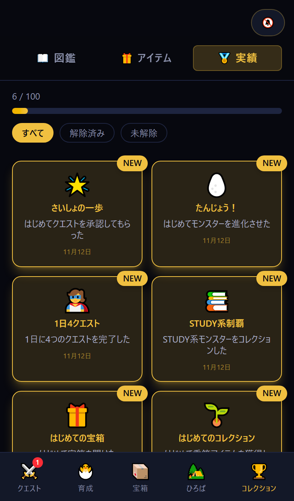
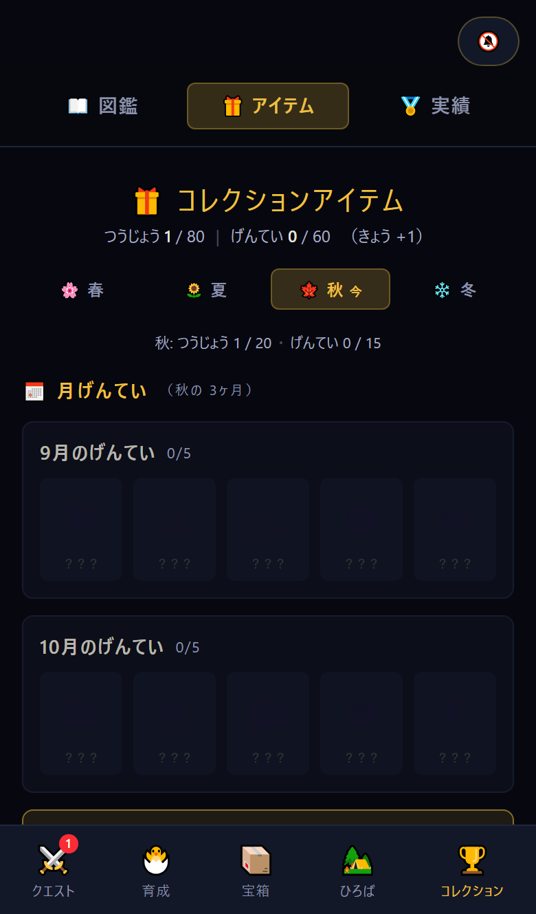

# ストリーク・実績・コレクション

毎日続けるとたまる「ストリーク」、条件を満たすと解除される「実績」、宝箱から出る「コレクションアイテム」について説明します。どれも、子どもが続ける楽しみを増やすための仕組みです。

| 仕組み | 何が数えられるか | もらえるもの |
|---|---|---|
| ストリーク | 毎日タスクを達成した連続日数 | 称号とボーナスポイント |
| タスクごとの連続記録 | 同じタスクを続けて達成した回数 | 🔥 表示 |
| ログインボーナス | アプリを開いた連続日数 | 10日ごとに 1pt |
| チェックイン | 決めた時刻までにクエスト画面を開いた連続日数 | 🔥 表示（ポイントなし） |
| 実績 | 100種類の条件 | 🏅 実績の解除 |
| コレクションアイテム | 宝箱から出た季節・月げんていのアイテム | 🎁 アイテム図鑑 |

---

## 1. ストリーク（毎日の連続達成）

### 1日の達成条件
その日のクエストのうち、**承認したクエストとスキップを承認したクエスト** の合計が「ストリーク最低タスク数」に達すると、その日は達成です。

- 「ストリーク最低タスク数」は **ファミリー設定 → 子どものカード → 🔥 ストリーク最低タスク数** で子どもごとに設定します（1〜20、初期値 1）。
- その日のタスクが最低タスク数より少ない日は、全部を承認（またはスキップ承認）すれば達成です。
  - 例: 最低タスク数が 3 で、その日のタスクが 2件 → 2件とも承認すれば達成
- 達成が決まるのは **おうちの人が承認したとき** です。報告しただけでは数えません。
- 承認が翌日以降になっても、**クエストの日付** の達成として数えます。
  - ただし、すでに新しい日の達成が記録されたあとで古い日を承認しても、連続日数は増えません。

### 連続日数の数え方
- 前日も達成していれば +1日、そうでなければ 1日目からやり直しです。
- **タスクが1件もない日があると、連続は途切れます。** 毎日続けさせたい場合は、毎日1件以上タスクがあるように設定してください。

### 称号とボーナスポイント
連続日数が次の日数に届くと、称号とボーナスポイントがもらえます。

| 連続日数 | 称号 | ボーナス |
|---|---|---|
| 3日 | 🔥 はじめの一歩 | 5pt |
| 7日 | ⚔️ 一週間の戦士 | 10pt |
| 30日 | 🌙 月の修行者 | 20pt |
| 100日 | 👑 伝説の冒険者 | 30pt |

- ボーナスポイントは 📚 学力・💪 体力・🌿 生活力に均等に分けて入ります。割り切れない分は学力に入ります（例: 5pt → 学力 2 / 体力 1 / 生活力 1）。
- ボーナスで進化することもあります。転生待ちのときは、ポイントだけ入って進化はしません。
- 連続が途切れたあと、もう一度その日数に届くと、ボーナスはまたもらえます。
- 称号を獲得すると、子どもの育成画面で「称号を獲得！ ＋○pt ゲット！」の演出が出ます。ひろばの掲示板にも流れます。

### 子どもの画面での表示
子どもの **育成** 画面のストリークカードに、次の内容が表示されます。

- 今の称号
- ○ 日連続
- 今月（今月、承認またはスキップ承認があった日数）
- 最高（これまでの最長連続日数）
- あと○日で「次の称号」

---

## 2. タスクごとの連続記録

タスク1つずつにも連続記録があります。子どものクエスト一覧と親のタスク一覧に「🔥○日」と表示されます。

- 数えるのは **承認されたとき** だけです。スキップは数えません。
- 曜日指定のタスクは、**そのタスクがある日** で連続を判断します。
  - 例: 月・水・金のタスク → 金曜のあと月曜に達成すれば連続（土日は関係ない）
- 一時的なタスク（その日だけのタスク）には連続記録がありません。

---

## 3. ログインボーナス

子どもがアプリを開くと、その日のログインとして記録されます（1日1回）。

- 前日も開いていれば +1日、1日でも開かない日があると 1日目からやり直しです。
- **10日連続ごと**（10日、20日、30日…）に **1pt** もらえます。「○日連続！ ログインボーナス ＋1pt ゲット！」の演出が出ます。
- ボーナスは、そのときいちばんポイントが少ないカテゴリに入ります。
- 親が子供モードで開いても、子どものログインには数えません。

---

## 4. チェックイン（朝のアプリ起動）

「決めた時刻までにクエスト画面を開く」習慣づけのための機能です。ポイントはもらえません。

### 設定
**ファミリー設定 → 子どものカード → 📅 チェックイン締切（JST）** に時刻を入れて「保存」します。空欄にすると（「クリア」）機能はオフです。

### 動き
- 締切時刻 **より前** に子どもがクエスト画面を開くと「チェックイン成功！」になり、連続日数が +1 されます。
- 締切時刻 **ちょうど以降** に初めて開いた場合は失敗になり、連続日数は 0 に戻ります。
- クエスト画面のいちばん上に、今日の状態が1行で出ます。
  - 成功: 「🔥 ○日連続！ 今日はチェックイン済み！」（1日目は「🔥 今日から連続スタート！」）
  - 失敗: 「今日はチェックインし忘れちゃったね。明日は○○までにチェックインしよう！」
- タップすると「直近7日 チェックイン」のカレンダーが開きます（🌟 成功 / 😢 失敗 / ⭐ 今日）。

---

## 5. 実績（バッジ）

条件を満たすと解除される実績が **100種類** あります。子どもの **コレクション → 🏅 実績** で見られます。

- 「すべて / 解除済み / 未解除」で絞り込めます。
- 未解除の実績は 🔒 で表示され、回数で数えるものは「あと ○ で解錠」と表示されます。
- 解除されると、子どもの画面に通知が出ます。ひろばの掲示板にも流れます。
- 解除の判定は、クエストの承認、子どものログイン、転生のタイミングで行われます。
- 一度解除された実績は消えません。

▼ 子どもの実績画面

### 数え方の共通ルール
- 「クエスト完了」「タスクを完了した日」は、**おうちの人が承認したクエスト** で数えます。スキップは含みません（スキップの実績を除く）。
- 日付は **クエストの日付** で数えます。
- 「週」は月曜〜日曜です。「月」はカレンダーの月です。

### ようこそ（3）
| 実績 | 条件 |
|---|---|
| 🌟 さいしょの一歩 | はじめてクエストを承認してもらった |
| 🥚 たんじょう！ | はじめてたまごが孵化した |
| 💡 アイデア採用！ | 自分で作ったタスクがはじめて承認された |

### 累計クエスト（8）
| 実績 | 条件 |
|---|---|
| 🎉 10回クリア！ | 承認されたクエストが累計 10回 |
| 🚀 25回クリア！ | 累計 25回 |
| 💯 50回クリア！ | 累計 50回 |
| 🌟 100回クリア！ | 累計 100回 |
| 🏆 200回クリア！ | 累計 200回 |
| 👑 300回クリア！ | 累計 300回 |
| 💎 500回クリア！ | 累計 500回 |
| 🌈 1000回クリア！ | 累計 1000回 |

### ストリーク（7）
| 実績 | 条件 |
|---|---|
| ⚡ 5日コンボ | ストリーク（毎日の連続達成）の最高記録が 5日 |
| 🔥 10日コンボ | 10日 |
| 💥 2週間バースト | 14日 |
| 🏆 3週間マスター | 21日 |
| 💎 1ヶ月チャンピオン | 30日 |
| 🌈 100日コンボ | 100日 |
| 🌟 ストリーク復活 | クエスト完了が途切れたあと、また7日続けてクエストを完了した |

### ログイン（4）
| 実績 | 条件 |
|---|---|
| 📅 1週間ログイン | ログインの連続日数の最高記録が 7日 |
| 🌱 2週間ログイン | 14日 |
| 🌿 1ヶ月ログイン | 30日 |
| 🏆 100日ログイン | 100日 |

### 累計ポイント（5）
ここでの累計ポイントは「承認されたクエスト数 ＋ 期限ボーナスの数 ＋ 写真ボーナスの数」です。進化や転生では減りません。「今日やる」宣言・ストリーク・ログインのボーナスは含みません。

| 実績 | 条件 |
|---|---|
| 💰 50pt貯めた | 累計 50pt |
| 💎 100pt貯めた | 累計 100pt |
| 🏅 300pt貯めた | 累計 300pt |
| 🏆 500pt貯めた | 累計 500pt |
| 👑 1000pt貯めた | 累計 1000pt |

### 写真（4）
写真を付けて報告し、承認されたクエストの数です（写真ボーナスの設定がないタスクも含みます）。

| 実績 | 条件 |
|---|---|
| 📸 写真15枚 | 15回 |
| 🤳 写真30枚 | 30回 |
| 🏆 フォトマスター | 100回 |
| 👑 フォトキング | 200回 |

### 期限ボーナス（4）
| 実績 | 条件 |
|---|---|
| 🎯 期限マスター10 | 期限ボーナス付きで承認されたクエストが 10回 |
| 💨 神速クリア | 50回 |
| 🏆 期限ファイター | 100回 |
| 👑 期限の覇者 | 200回 |

### 時間帯・すばやさ（5）
| 実績 | 条件 |
|---|---|
| 🌅 朝活デビュー | 朝 8時前に報告したクエストが 10回 |
| ☀️ 朝活の人 | 朝 8時前に報告したクエストが 30回 |
| ☕ 放課後ファイター | 15時〜18時に報告したクエストが 15回 |
| 🚀 思い立ったが吉日 | クエストができてから 30分以内に報告したクエストが 10回 |
| ⚡ 即行動の達人 | 同じく 30回 |

### 1日の達成（6）
「パーフェクトデイ」は、その日のクエストが全部「承認」または「スキップ承認」になった日です（今日は含みません）。

| 実績 | 条件 |
|---|---|
| 🎯 パーフェクト5回 | パーフェクトデイが 5日 |
| 💪 パーフェクト15回 | 15日 |
| 🌟 パーフェクト30回 | 30日 |
| 👑 パーフェクト50回 | 50日 |
| 🦸 1日4クエスト | 1日に 4件のクエストが承認された |
| 💥 1日6クエスト | 1日に 6件のクエストが承認された |

### 週の達成（5）
| 実績 | 条件 |
|---|---|
| 📅 週5達成 | 1週間のうち 5日以上クエストを完了した週が 1回 |
| 🌟 週5を3回 | その週が 3回 |
| 🏆 週5を10回 | その週が 10回 |
| 💯 週7パーフェクト | 1週間の 7日すべてでクエストを完了した週が 1回 |
| 👑 週7を5回 | その週が 5回 |

### 月の達成（5）
| 実績 | 条件 |
|---|---|
| 📅 月15日達成 | 1か月のうち 15日以上クエストを完了した月が 1回 |
| 📅 月20日達成 | 20日以上の月が 1回 |
| 🏆 皆勤賞 | その月の全日でクエストを完了した月が 1回 |
| 👑 3ヶ月皆勤 | 皆勤の月が 3回 |
| 🌟 半年コツコツ | 15日以上の月が 6回 |

### 転生（5）
| 実績 | 条件 |
|---|---|
| ♻️ はじめての転生 | 転生 1回 |
| ♻️ 転生2回 | 2回 |
| ♻️ 転生3回 | 3回 |
| ♻️ 転生5回 | 5回 |
| 👑 転生の達人 | 10回 |

### モンスターコレクション（6）
| 実績 | 条件 |
|---|---|
| 🎨 コレクター3 | 図鑑に記録されたモンスター（第1〜第3形態、全テーマの合計）が 3体 |
| 🎨 コレクター6 | 6体 |
| 📚 STUDY系制覇 | 📚 学力系のモンスターが孵化したことがある |
| 💪 STAMINA系制覇 | 💪 体力系のモンスターが孵化したことがある |
| 🏠 LIFE系制覇 | 🌿 生活力系のモンスターが孵化したことがある |
| 🌈 全系統制覇 | 上の3系統すべて |

### 自分で考える・続ける（7）
| 実績 | 条件 |
|---|---|
| 💡 アイデアマン5 | 自分で作ったタスクが 5個承認された |
| 💡 アイデアマン15 | 15個 |
| 🚀 クリエイター | 30個 |
| 🔁 習慣メーカー | 1つのタスクの連続記録が 14回 |
| 🔁 習慣の鬼 | 30回 |
| 🔁 習慣の達人 | 60回 |
| 🧠 自己認識上手 | スキップが承認された回数が 10回 |

### 曜日・季節（8）
年をまたいで合計します。

| 実績 | 条件 |
|---|---|
| 💪 月曜日の勇者 | 月曜日にクエストを完了した日が 10日 |
| 🎉 週末ヒーロー | 土日にクエストを完了した日が 20日 |
| 🌸 春のスタート | 4月にクエストを完了した日が 15日 |
| 🌻 夏の陣 | 7〜8月に 20日 |
| 🍂 秋の集中 | 9〜10月に 20日 |
| ⛄ 冬のぼうけん | 12〜1月に 20日 |
| 🎌 お正月ファイター | 1月1〜3日にクエストを完了した |
| 🗓️ 月末ファイター | 月の最後の3日間にクエストを完了した日が 10日 |

### チャレンジ（10）
| 実績 | 条件 |
|---|---|
| 🌟 実績25個解除 | ほかの実績を 25個解除した |
| 🌟 実績50個解除 | 50個 |
| 👑 実績75個解除 | 75個 |
| 👑 実績90個解除 | 90個 |
| 🔥 マルチタスカー | 同じ日に「期限ボーナス付き」と「写真付き」の承認がどちらもあった |
| ⚡ スピードスター | 1週間の 7日すべてで期限ボーナスを獲得した |
| 💪 三冠王 | 「期限ボーナス付き」と「写真付き」の承認がどちらもあった日が 25日 |
| 🌈 カムバックキング | クエスト完了が途切れたあと、また14日続けた |
| 🌈 カムバックキング2 | 2回以上途切れたあと、また7日続けた |
| 💪 折れない心 | 差し戻されたあと再報告して承認されたクエストが 10回 |

### 宝箱（3）
| 実績 | 条件 |
|---|---|
| 🎁 はじめての宝箱 | はじめて宝箱を開けた |
| 🗝️ 宝箱コレクター | 宝箱を累計 25個開けた |
| 💎 レア当選！ | 「たまに」（★★★）のごほうびを引き当てた |

### コレクションアイテム（4）
| 実績 | 条件 |
|---|---|
| 🌱 はじめてのコレクション | はじめてコレクションアイテムを手に入れた |
| 📦 アイテム30種 | コレクションアイテムを 30種類集めた（月げんていも含む） |
| 🍀 シーズン制覇 | 1つの季節の「つうじょう」アイテム 20種をすべて集めた |
| 🌌 全アイテム制覇 | 「つうじょう」アイテム 80種をすべて集めた |

### 転生の卵（1）
| 実績 | 条件 |
|---|---|
| 🥚 卵えらびマスター | 転生で勉強・体力・生活力のどれかの卵を選んだ |

---

## 6. コレクションアイテム

宝箱を開けてごほうびが出なかったとき、代わりに **コレクションアイテム** が1つもらえます（宝箱の章を参照）。

### アイテムの種類
全部で **140種類** あります。

| 種類 | 数 | 内容 |
|---|---|---|
| つうじょう | 80種 | 春・夏・秋・冬 × 20種（いきもの・たべもの・ほうせき・どうぐ・しぜん） |
| 月げんてい | 60種 | 1〜12月 × 5種（その月の行事など。「ほうせき」は毎月の誕生石） |

季節は次のとおりです（日本時間で月初に切り替わります）。

| 季節 | 月 |
|---|---|
| 春 | 3〜5月 |
| 夏 | 6〜8月 |
| 秋 | 9〜11月 |
| 冬 | 12〜2月 |

### 出るアイテム
| プラン | 出るアイテム |
|---|---|
| プレミアムプラン | 今の季節の「つうじょう」20種 ＋ 今月の「月げんてい」5種 |
| 無料プラン | 今月の「月げんてい」5種だけ |

- レア度は ★（60%）・★★（30%）・★★★（10%）の順に出やすくなっています。
- 同じレア度の中では、**まだ持っていないアイテムが3倍出やすく** なっています。
- 同じアイテムを何回も手に入れることがあります。その場合は「×2」のように数が増えます。
- 月げんていアイテムは、その月が終わると次の年のその月まで手に入りません。

### 子どもの画面
**コレクション → 🎁 アイテム** で見られます。

- いちばん上に「つうじょう ○ / 80 | げんてい ○ / 60」と表示されます。その日に手に入れた分は「（きょう +○）」と出ます。
- 季節のタブ（🌸 春 / 🌻 夏 / 🍁 秋 / ❄️ 冬）で切り替えます。今の季節には「今」が付きます。
- 「📅 月げんてい」には、その季節の3か月分が月ごとに並びます。今月には「◀今月 のこり○日！」、まだ来ていない月には「○月になったらとうじょう！」と表示されます。
- まだ持っていないアイテムは影（シルエット）で表示されます。
- アイテムを押すと、季節・種類・レア度と説明が見られます。

▼ 子どものコレクションアイテム画面

---

## よくある質問

**Q. 毎日やっているのにストリークが途切れた**
次のどれかが考えられます。
- タスクが1件もない日があった
- その日の承認（またはスキップ承認）の数が「ストリーク最低タスク数」に届かなかった
- 報告はしていたが、承認していなかった（承認していない日は達成になりません）

**Q. 前の日の分をあとから承認したら、ストリークはどうなる？**
クエストの日付で数えるので、その日の達成になります。ただし、すでにそれより新しい日の達成が記録されている場合は、連続日数は増えません。

**Q. ログインボーナスが入らない**
ログインボーナスは10日連続ごとです。1日でもアプリを開かない日があると、1日目からやり直しです。

**Q. 実績の条件を満たしたはずなのに解除されない**
実績の判定は、クエストの承認・子どものログイン・転生のときに行われます。次にどれかが起きたときに解除されます。

**Q. コレクションアイテムが月げんていばかり出る**
無料プランでは、月げんていアイテムだけが出ます。季節の「つうじょう」アイテムはプレミアムプランで出るようになります。
