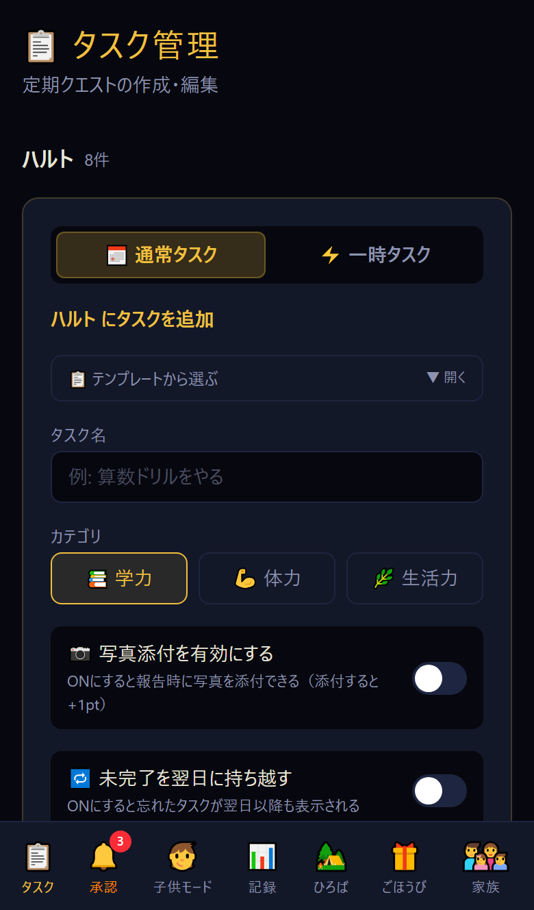
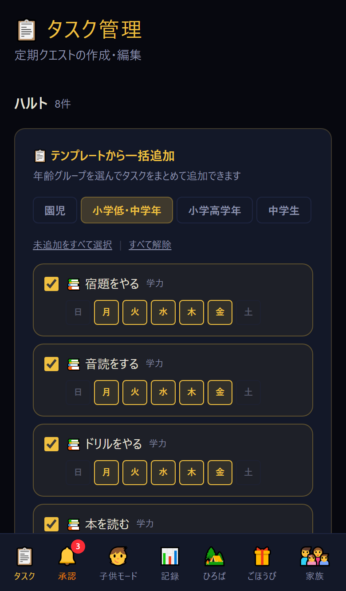
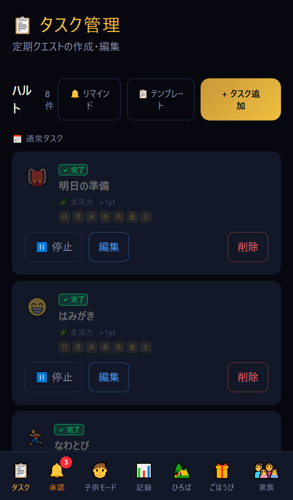

# タスク管理

子どもにやってほしいことを「タスク」として登録します。登録したタスクは、決めた曜日や日付になると子どもの画面に「クエスト」として出てきます。

この章では、タスクの作り方、タスクの種類と設定項目、停止・削除、子どもからのタスク申請、テンプレートでのまとめて追加、リマインドを説明します。

---

## 1. 全体の流れ

```
おうちの人がタスクを登録（タスク管理）
  → 曜日・日付が来ると、子どもの画面にクエストとして表示される
  → 子どもが報告
  → おうちの人が承認 → XP（pt）が入る
```

- タスク管理は、ナビの **📋 タスク管理** から開きます。
- 子どもが2人以上いる場合は、画面上部で子どもを切り替えます。子どもを切り替えると、開いていた入力フォームは閉じます。
- 各子どもの名前の横に、登録済みのタスク件数（例: 「5件」）が出ます。0件のときは「タスクなし」です。

---

## 2. タスクの種類

| 種類 | 表示される日 | 使いどころ |
|---|---|---|
| 📅 通常タスク | 選んだ曜日に毎週 | 宿題、歯みがきなど毎日・毎週やること |
| ⚡ 一時タスク | 指定した1日だけ | 「今日だけ」「〇日だけ」やってほしいこと |

---

## 3. タスクを追加する

1. 子どもの名前の右にある **+ タスク追加** を押します。
   - タスクが1件もないときは「✏️ 自分で作る」でも開けます。
2. 上部のタブで **📅 通常タスク** か **⚡ 一時タスク** を選びます。
3. 各項目を入力します（下の表）。
4. **作成** を押します。やめるときは **キャンセル** を押します。

▼ タスクの追加フォーム



### 入力する項目

| 項目 | 内容 | 通常 | 一時 |
|---|---|---|---|
| 📋 テンプレートから選ぶ | 押すと例文の一覧が開きます。選ぶとタスク名とカテゴリが入ります（[7. テンプレート](#7-テンプレートでまとめて追加する) を参照） | ○ | ○ |
| タスク名 | 必須。32文字まで（例: 算数ドリルをやる） | ○ | ○ |
| カテゴリ | 📚 学力 / 💪 体力 / 🌿 生活力 のどれか（初期値は 📚 学力） | ○ | ○ |
| 📷 写真添付を有効にする | ONにすると子どもが報告時に写真を付けられます。付けると +1pt | ○ | ○ |
| 🔁 未完了を翌日に持ち越す | ONにすると、やり忘れたタスクが翌日以降も残ります | ○ | ※ |
| 繰り返し | 表示する曜日（日〜土）。初期値は月〜金 | ○ | — |
| 実施日 | 表示する日。空欄なら今日 | — | ○ |

※ 一時タスクの画面にも「🔁 未完了を翌日に持ち越す」のスイッチは出ますが、現在の仕組みでは一時タスクには反映されません（持ち越しなしで作成されます）。

### カテゴリとXPの関係

カテゴリは、承認したときにどの能力値にXPが入るかを決めます。

| カテゴリ | 入る能力値 |
|---|---|
| 📚 学力 | 学力 |
| 💪 体力 | 体力 |
| 🌿 生活力 | 生活力 |

能力値のバランスでモンスターの進化先が変わります（詳しくは「モンスターの育成と進化」の章を参照）。

---

## 4. タスク1件でもらえるXP

承認したときに入るXPは次の合計です。

| 内訳 | XP | 条件 |
|---|---|---|
| 基本 | +1 | 承認されたとき必ず |
| 期限ボーナス | +1 | 報告期限より前に報告した |
| 写真ボーナス | +1 | 「写真添付を有効にする」がONのタスクで、写真を付けて報告した |
| 今日やる宣言ボーナス | +1 | 子どもが「今日やる」と宣言した日に報告した |

- **報告期限** は子どもごとに **ファミリー → ⏰ 報告期限（JST）** で設定します。未設定なら期限ボーナスはありません。
  - 期限ちょうどの時刻に報告した場合はボーナスになりません。
  - 判定は最初の報告時だけです。差し戻し後に報告し直しても、ボーナスの有無は変わりません。
  - 期限はそのクエストの日付の時刻で判定します。持ち越されて翌日以降に報告した場合は、元の日の期限を過ぎているのでボーナスになりません。
- **今日やる宣言** は、しばらく（3回以上）やれていないタスクにだけ子どもの画面に出るボタンです。
- タスクカードには、もらえる見込みのXPが「+1pt」「+1〜2pt」「+1〜3pt」のように出ます（期限の設定と写真ONかどうかで変わります）。
- スキップを承認したタスクにはXPは入りません。

---

## 5. 子どもの画面に出るタイミング

- 日付の切り替えは **日本時間（JST）の0時** です。
- その日のクエストは、子どもがアプリを開いたとき、またはおうちの人がタスク管理を開いたとき・リマインドを送ったときに作られます。
- 通常タスクは「今日の曜日」が繰り返しに入っていれば出ます。今日が対象外の曜日のタスクは、タスク管理で薄く表示され「対象外」と出ます。
- 一時タスクは実施日の当日だけ出ます。実施日を過ぎた一時タスクはタスク管理の一覧から消えます。

### 一度作られたクエストについて

- タスク名やカテゴリを編集しても、**その日すでに子どもの画面に出ているクエストには反映されないことがあります**。次に表示される日から反映されます。

---

## 6. 未完了を翌日に持ち越す（🔁）

ONにした通常タスクは、やり残すと翌日以降も子どもの画面に残り続けます。

- 残っている間は、同じタスクが2つ並ぶことはありません（1つだけ表示されます）。
- 報告して承認されるか、スキップが承認されると、次の繰り返し曜日から新しいクエストが出ます。
- やり残しが続くと、タスク管理のカードに「🔁 〇回未完了」と出ます。
- OFFのタスクは、その日のうちに報告しなければ翌日には出ません。

---

## 7. テンプレートでまとめて追加する

子どもの名前の右にある **📋 テンプレート** を押すと、「📋 テンプレートから一括追加」が開きます（タスクが0件のときは「📋 テンプレートから始める」）。

1. 年齢グループを選びます。

   | 年齢グループ |
   |---|
   | 園児 |
   | 小学低・中学年（初期表示） |
   | 小学高学年 |
   | 中学生 |

2. 追加したいタスクにチェックを入れます。
   - 「未追加をすべて選択」「すべて解除」でまとめて操作できます。
   - すでに同じ名前のタスクがあるものには「作成済」と出ます。
   - タスクごとに曜日を変えられます（初期値は月〜金）。
3. **〇件を追加** を押します。

- 一度に追加できるのは30件までです。
- テンプレートから追加したタスクは、写真添付OFF・持ち越しOFFの通常タスクになります。あとから編集で変えられます。
- 無料プランでは「無料プランのタスク上限まで、あと〇件選べます」と表示され、それ以上は選べません。

▼ テンプレートから一括追加



---

## 8. タスクカードの見方

タスク管理の一覧は3つに分かれます。

| 見出し | 中身 |
|---|---|
| 🙋 申請中 | 子どもが自分で追加したタスク（[10. 子どもからのタスク申請](#10-子どもからのタスク申請) を参照） |
| 📅 通常タスク | おうちの人が作った通常タスク |
| ⚡ 一時タスク | おうちの人が作った一時タスク（実施日が今日以降のもの） |

カードに出る表示:

| 表示 | 意味 |
|---|---|
| ⏸ 停止中 | 停止している（子どもの画面に出ない） |
| ✓ 完了 | 今日の分が承認済み |
| 🔥〇日 | このタスクを続けて達成している日数 |
| ⏭ 今日スキップ / 昨日スキップ / 〇日前スキップ | 直近でスキップした日（停止していた期間は数えません） |
| 🔁 〇回未完了 | 持ち越しタスクのやり残しが続いている回数 |
| 対象外 | 今日は繰り返しの曜日に入っていない |
| 📷 | 写真添付ON |
| 🔁（小さいアイコン） | 持ち越しON |
| 📅 〇/〇 | 一時タスクの実施日 |
| 曜日の列 | 金色の曜日が表示される曜日 |

▼ タスク管理画面の通常タスク一覧



---

## 9. 編集・停止・削除

### 編集する
通常タスクのカードの **編集** を押すと、フォームが開きます。変更して **更新** を押します。

- 編集で変えられるのは、タスク名・カテゴリ・写真添付・持ち越し・繰り返しの曜日です。
- 一時タスクには「編集」ボタンがありません。変えたいときは削除して作り直してください。

### 一時的に止める（⏸ 停止）
しばらくお休みしたいタスクは、**⏸ 停止** を押します。

- 停止中は子どもの画面に出ません。その日すでに出ていたクエストや、持ち越し中のクエストも見えなくなります。
- 曜日や実施日の設定は残ります。**▶ 再開** を押すと元に戻ります。
- 停止中のタスクは、無料プランのタスク数に数えません。ただし再開するときに上限を超えていると再開できません。
- 停止していた期間は、スキップからの経過日数に数えません。

### 削除する
**削除** を押すと確認画面（「このタスクを削除しますか？」）が出ます。OKで削除します。

- 削除すると、子どもの画面からすぐに消えます。
- おうちの人が作ったタスクを削除しても、これまでに入ったXPや記録は残ります。

---

## 10. 子どもからのタスク申請

子どもも自分のタスクを追加できます。子どもが追加すると、おうちの人に「📋 タスク申請」の通知が届き、タスク管理の **🙋 申請中** に「仮」の印つきで表示されます。

| 子どもが追加した種類 | 子どもの画面での扱い |
|---|---|
| 通常タスク | 承認されるまでは、申請した日だけ表示されます。翌日以降は承認されるまで出ません |
| 一時タスク | 追加したその日に表示されます |

申請中のカードでできること:

| ボタン | 動き |
|---|---|
| 承認 | おうちの人のタスクとして正式に登録します。以降は通常の曜日どおりに出ます |
| 編集 | 内容を直します。ボタンが「更新して承認」になり、押すと直した内容で承認されます |
| 却下 | タスクを取り消します（確認画面が出ます） |

- **却下すると、そのタスクで子どもが報告したクエストはすべて差し戻し扱いになり、すでに承認して入ったXPも差し引かれます。**
- 申請中のカードには、申請した日（「申請日:〇/〇」）が出ます。
- 子どもが追加できるタスク数にも、無料プランの上限がかかります。上限に達すると、子どもの画面には「これいじょうタスクをふやせないよ。ママ・パパにおねがいしてね！」と出ます。

---

## 11. 一時タスクを次の日に送る（スキップ時）

子どもが一時タスクをスキップ申請した場合、承認するときに同じタスクを別の日に作り直せます。

- **承認画面**: スキップ申請のカードにある「📅 次の日に送る」にチェックを入れ、日付を選んでから承認します。
- **今日の完了タスク**: スキップ承認済みの一時タスクに「📅 次の日に送る」ボタンが出ます。日付を選んで押すと、「✓ 翌日に送りました」と出ます。

- 日付の初期値は翌日です。今日より前の日は選べません。
- 同じ日に同じ名前の一時タスクがすでにあれば、新しくは作られません。
- 送った先のタスクは、写真添付OFFで作られます。
- 無料プランでタスク上限に達していると送れません（スキップの承認自体は完了します）。

---

## 12. リマインドを送る

子どもの名前の右にある **🔔 リマインド** を押すと、子どもの端末に「⏰ リマインド」の通知が届きます。

- 通知には、今日まだ報告していないタスクの名前が並びます（例: 「宿題をやる、音読をするがまだ終わってないよ！」）。
- 送れたら「リマインドを送りました！」と出ます。
- 今日の未完了タスクがないときは送れません（「未完了のクエストがありません」と出ます）。
- 子どもの端末で通知を許可していないと届きません。

---

## 13. 登録できるタスクの数

| プラン | 子ども1人あたり |
|---|---|
| 無料プラン | 10件まで |
| プレミアムプラン | 無制限 |

数え方:
- 数えるのは、削除していない・停止していないタスクです。
- 実施日を過ぎた一時タスクは数えません。
- 子どもが申請中のタスクも数えます。

上限に達すると「無料プランではタスクは10個までです。プレミアムプランで無制限になります。」と出ます。

---

## よくある質問

**Q. 作ったタスクが子どもの画面に出ない**
次を確認してください。
- 今日の曜日が「繰り返し」に入っているか（カードに「対象外」と出ていないか）
- 「⏸ 停止中」になっていないか
- 一時タスクなら、実施日が今日になっているか

**Q. タスク名を直したのに、子どもの画面が古いまま**
その日すでに表示されているクエストには反映されないことがあります。次に表示される日から新しい名前になります。

**Q. やり忘れたタスクが次の日に消えている**
「🔁 未完了を翌日に持ち越す」がOFFのタスクは、その日のうちに報告しないと翌日には残りません。残したいタスクは編集でONにしてください。

**Q. 一時タスクの日付を変えたい**
一時タスクは編集できません。削除して作り直してください。

**Q. 子どもが追加したタスクを却下したら、XPが減った**
却下すると、そのタスクで入ったXPは差し引かれます。続けてほしいタスクなら「承認」してください。

**Q. タスクを追加しようとしたら上限のメッセージが出た**
無料プランは子ども1人あたり10件までです。使っていないタスクを停止・削除するか、プレミアムプランにしてください。

**Q. リマインドが届かない**
子どもの端末で通知が許可されているか確認してください。また、今日の未完了タスクがない場合は送れません。
