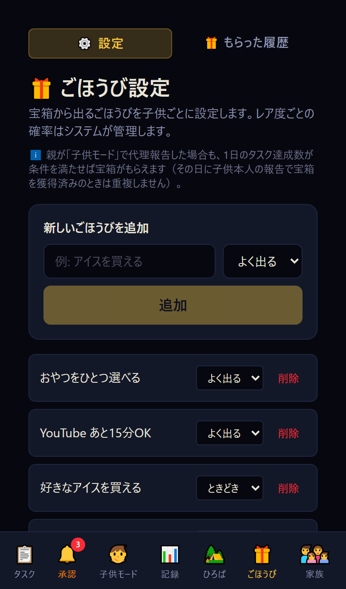
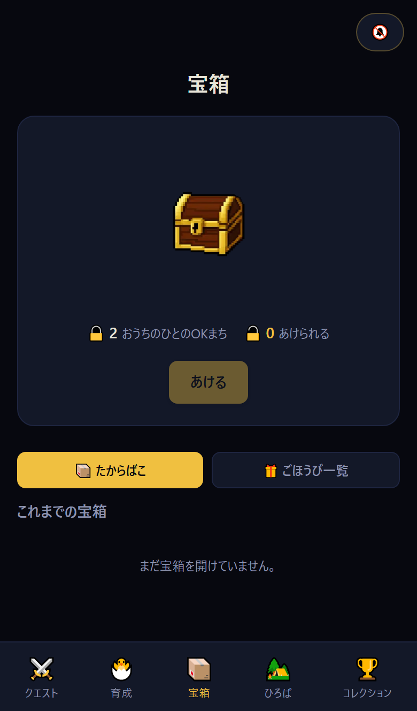
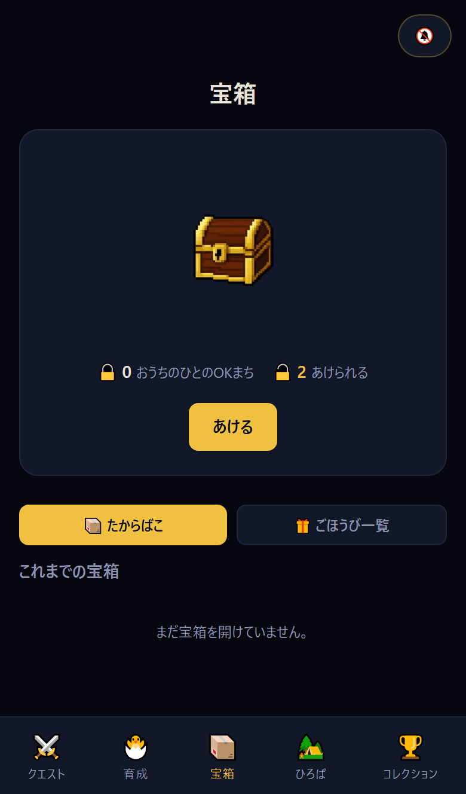
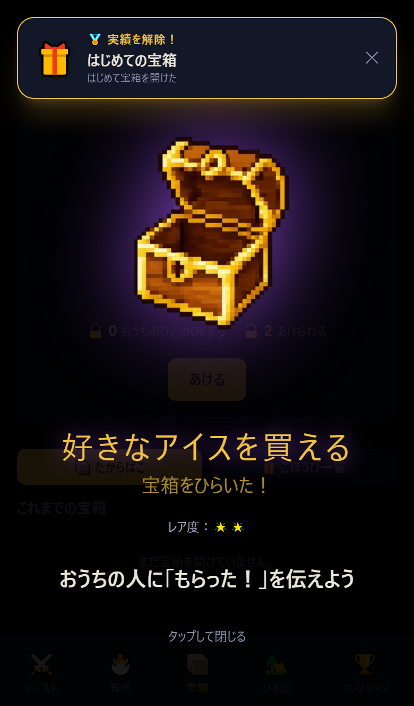
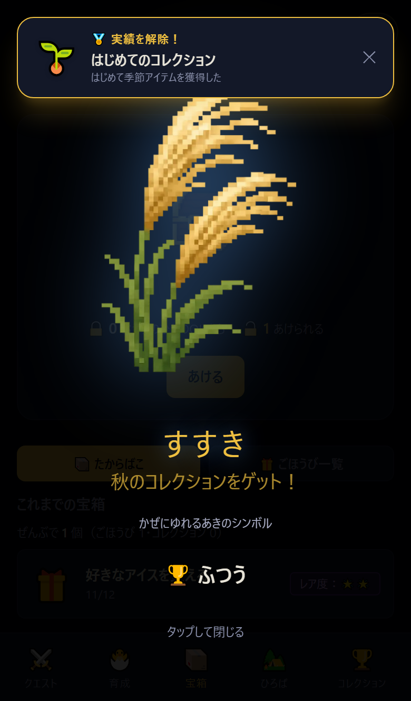
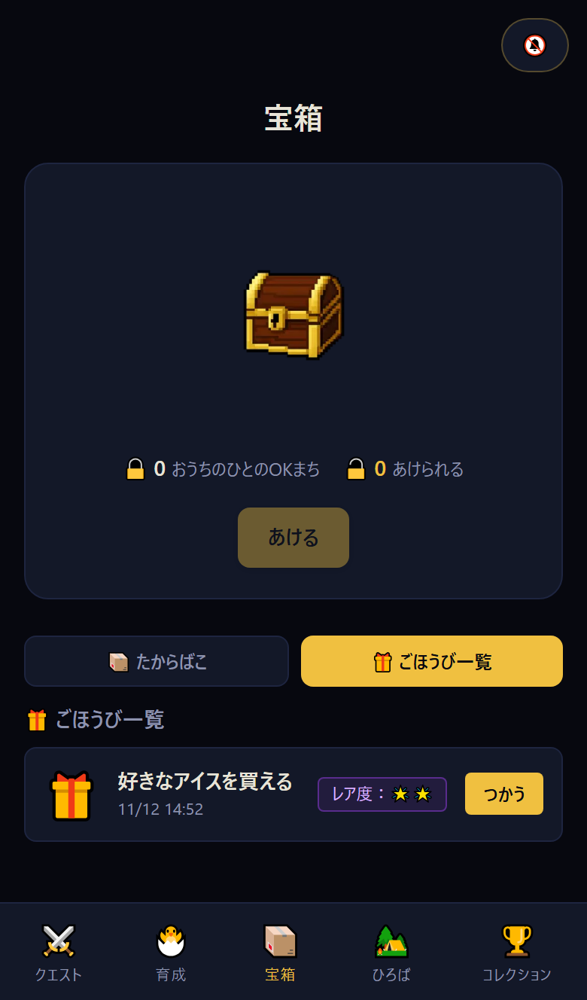
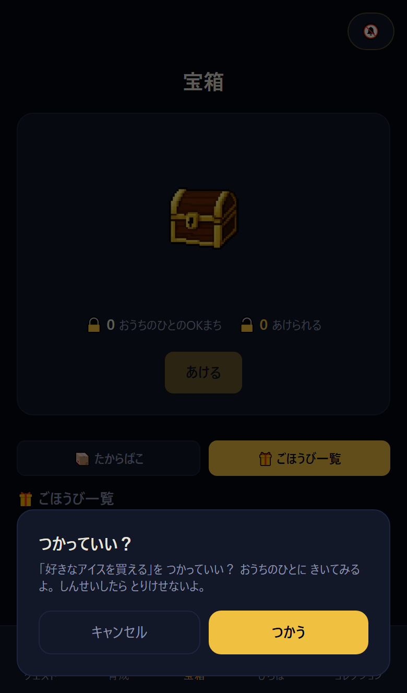
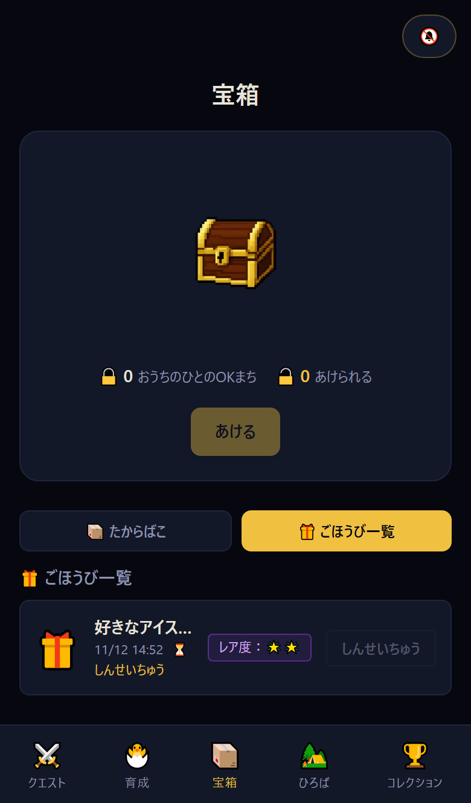
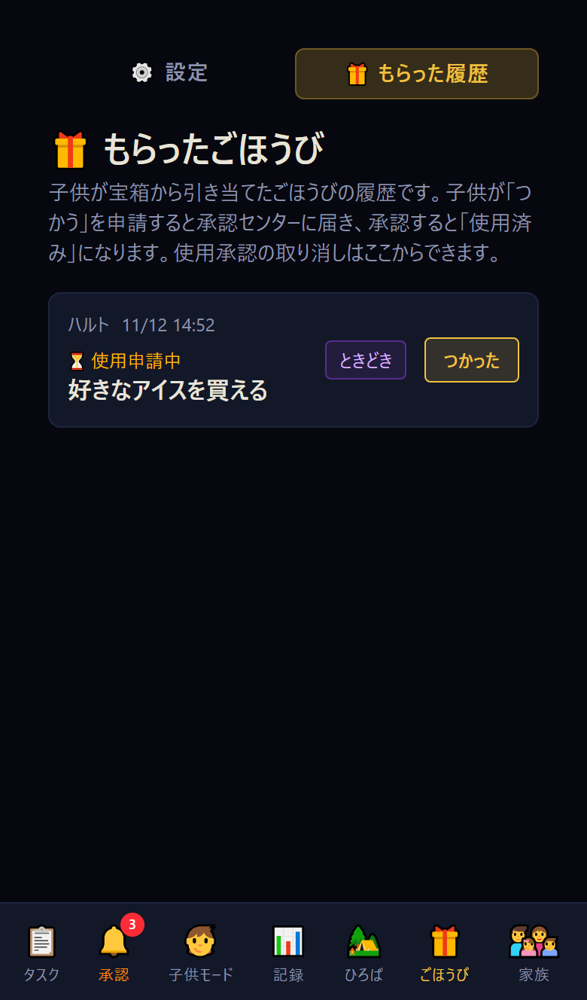
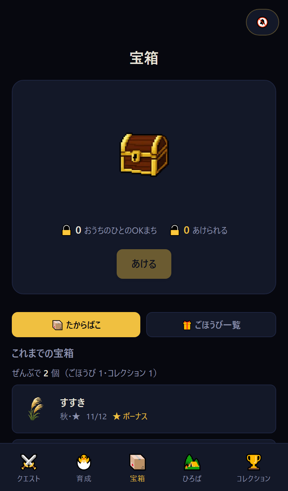

# 宝箱とごほうび

その日のタスクをがんばると、子どもは宝箱をもらえます。宝箱を開けると、おうちの人が登録した「ごほうび」か、季節の「コレクションアイテム」が出てきます。

この章では、宝箱をもらう条件、ごほうびの登録、子どもが「つかう」と申請したときの対応を説明します。

---

## 1. 全体の流れ

```
子どもがタスクを報告
  → 条件を満たすと宝箱が出る（🔒 おうちの人のOKまち）
  → おうちの人が報告を承認
  → 宝箱が開けられるようになる（🔓 あけられる）
  → 子どもが宝箱を開ける
  → ごほうび または コレクションアイテムが出る
  → 子どもが「つかう」を申請（ごほうびのみ）
  → おうちの人が承認センターで承認 → 「使用済み」になる
```

---

## 2. 宝箱がもらえる条件

宝箱は 1日に最大 2個です。

| 宝箱 | もらえる条件 |
|---|---|
| ふつうの宝箱 | その日に報告したタスクの数が「ストリーク最低タスク数」以上になったとき |
| 全部クリアの宝箱 | その日のタスクを全部報告したとき（ふつうの宝箱に加えてもう1個） |

- 「ストリーク最低タスク数」は **ファミリー設定 → 子どものカード → 🔥 ストリーク最低タスク数** で子どもごとに変えられます（初期値は 1）。
- その日のタスクが最低タスク数より少ない日は、全部報告すれば条件を満たしたことになります。
  - 例: 最低タスク数が 3 で、その日のタスクが 2件だけ → 2件とも報告すれば宝箱がもらえます。
- 全部クリアの宝箱は、スキップしたタスクが **1件もない** と「★ ボーナス」付きになり、ごほうびが出やすくなります（[5. 中身の決まり方](#5-宝箱の中身の決まり方) を参照）。
- 同じ日に同じ種類の宝箱は 1個までです。何度報告し直しても増えません。

### 宝箱が開けられるようになるタイミング

- 子どもが報告した直後の宝箱は 🔒「おうちの人のOKまち」です。まだ開けられません。
- おうちの人が **その日の報告を承認すると** 🔓「あけられる」になります。

### 差し戻すと宝箱はどうなるか

報告を差し戻した結果、条件を満たさなくなった宝箱は消えます。

- 報告数が最低タスク数を下回った → その日のまだ開けていない宝箱はすべて消えます
- 最低タスク数は満たしているが「全部報告」ではなくなった → 全部クリアの宝箱だけ消えます
- 開けた後の宝箱は消えません

### 子供モードで代わりに報告したとき

親が「子供モード」で代わりに報告・承認した場合も、条件を満たせば宝箱が出ます。この場合は承認待ちがないため、最初から 🔓「あけられる」の状態で出ます。

- その日に子ども本人の報告ですでに宝箱をもらっている場合は、重複して出ません。

---

## 3. ごほうびを登録する

**ごほうび設定**（ナビの 🎁 ごほうび → ⚙️ 設定タブ）で、宝箱から出るごほうびを子どもごとに登録します。

### 追加する
1. 子どもが2人以上いる場合は、画面上部で子どもを選びます。
2. 「新しいごほうびを追加」にごほうびの名前を入力します（100文字まで。例: アイスを買える）。
3. 出やすさを選びます。

   | 表示 | 子ども側の表示 | 意味 |
   |---|---|---|
   | よく出る | ★ | 気軽にあげられるもの |
   | ときどき | ★★ | 少し特別なもの |
   | たまに | ★★★ | めったに出ない、とっておきのもの |

4. 「追加」を押します。

▼ ごほうび設定画面



### おすすめセットで始める（プレミアムプラン）
ごほうびが1つも登録されていないとき、「おすすめセットで始める」を押すと、20件のごほうびをまとめて登録できます。登録後に名前や出やすさを変えたり、消したりできます。

<details>
<summary>おすすめセットの中身</summary>

- よく出る: おやつをひとつ選べる / デザートを選べる / 今日のごはんリクエスト権 / YouTube あと15分OK / 寝る時間15分延長 / 入浴剤を選べる / 宿題の順番を自分で決められる
- ときどき: 好きなアイスを買える / お手伝い1回パス券 / 映画をひとつ選んで家族で観る / ゲーム +30分延長 / 夕飯メニュー決定権 / 週末の行き先リクエスト権 / 好きなジュースを買える
- たまに: 好きな本・マンガ1冊 / 友達とお出かけ（親が送迎）/ 好きな文房具を買える / 家族ゲーム大会の種目決定権 / 1日だけ夜ふかしOK券 / 週末に行きたいところに連れていってもらえる

</details>

### 出やすさを変える・削除する
- 一覧の各ごほうびの右にある選択欄で、出やすさを変えられます。
- 「削除」で消せます。すでに子どもが引き当てた分の履歴は残ります。

### 登録できる数
| プラン | 子ども1人あたり |
|---|---|
| 無料プラン | 5件まで |
| プレミアムプラン | 無制限 |

---

## 4. 子どもが宝箱を開ける

子どもの **宝箱** 画面で「あける」を押すと開きます。

- 開けられる宝箱が複数あるときは、古いものから順に開きます。
- 親が子供モードの宝箱画面から開けることもできます。

▼ 子どもの宝箱画面（おうちの人のOKまち）



▼ 子どもの宝箱画面（あけられる）



▼ 宝箱を開けてごほうびが出たところ



▼ 宝箱を開けてコレクションアイテムが出たところ



---

## 5. 宝箱の中身の決まり方

宝箱を開けると、まず「ごほうびが出るかどうか」が抽選で決まります。

| 結果 | ふつう | ★ ボーナス付き |
|---|---|---|
| ごほうび（たまに） | 約 2.2% | 約 3.3% |
| ごほうび（ときどき） | 5% | 7.5% |
| ごほうび（よく出る） | 10% | 15% |
| コレクションアイテム | 約 82.8% | 約 74.2% |

- ごほうびが出なかったときは、その季節の **コレクションアイテム** が必ず1つもらえます。宝箱が空になることはありません。
- **10回続けてごほうびが出なかったら、次の宝箱では必ずごほうびが出ます。** このときは「よく出る」のごほうびが優先されます。
- 当たった出やすさのごほうびが登録されていない場合は、1つ下の出やすさのごほうびが出ます（例: 「たまに」に当たったが「たまに」が0件 → 「ときどき」から出る）。それもなければコレクションアイテムになります。
- ごほうびを1件も登録していなくても宝箱はもらえます。中身はすべてコレクションアイテムになります。

---

## 6. 子どもが「つかう」を申請したとき

子どもは宝箱画面の **🎁 ごほうび一覧** で、もらったごほうびの「つかう」を押せます。

1. 子どもが「つかう」を押すと、確認画面（「つかっていい？ おうちのひとに きいてみるよ」）が出ます。
2. 子どもが申請すると、**承認センター** に「〇〇からのごほうび使用申請」が届きます。子ども側の表示は「⏳ しんせいちゅう」になります。
3. おうちの人が選びます。
   - **✓ 使用を承認** → 「使用済み」になり、子ども側は「✅ つかったよ」になります。
   - **却下** → 未使用に戻ります。子どもはもう一度申請できます。

- 子どもは自分で申請を取り消せません。間違えて申請したときは、おうちの人が却下してください。
- 誤タップを防ぐため、使用申請はカード全体を押しても承認されません。必ずボタンを押してください。

▼ 子どもの「ごほうび一覧」



▼ 「つかう」を押したときの確認



▼ 申請したあと（しんせいちゅう）



---

## 7. もらったごほうびの履歴（親）

**もらったごほうび**（ナビの 🎁 ごほうび → 🎁 もらった履歴タブ）で、子どもが引き当てたごほうびの一覧を見られます。

| 表示 | 意味 |
|---|---|
| 未使用 | まだ使っていない |
| ⏳ 使用申請中 | 子どもが「つかう」を申請していて、承認待ち |
| ✅ 使用済み | 使い終わった |
| 🚫 子画面では非表示 | 開けてから30日を過ぎたため、子どもの画面には出ない（親の画面には残る） |

▼ もらったごほうび（使用申請中）



### 申請なしで使用済みにする
子どもが申請していなくても、「つかった」を押すと使用済みにできます（確認画面が出ます）。その場でごほうびをあげたときに使います。

### 使用済みを取り消す
間違えて承認したときは「使用を取り消す」で未使用に戻せます。

---

## 8. 子どもの画面で見られるもの

- **たからばこ** タブ: 宝箱の状態（🔒 おうちの人のOKまち / 🔓 あけられる）と「あける」ボタン
- **🎁 ごほうび一覧** タブ: もらったごほうびと「つかう」ボタン
- **これまでの宝箱**: 開けた宝箱の履歴。ごほうびとコレクションの数、★ ボーナス付きだったかどうか
- 子どもの画面に出るのは、開けてから **30日以内** の分だけです。

▼ 子どもの「これまでの宝箱」



---

## よくある質問

**Q. 宝箱が「おうちの人のOKまち」のまま開けられない**
その日の報告をまだ承認していません。承認センターで承認してください。

**Q. 宝箱が消えた**
報告を差し戻して、その日の条件（最低タスク数・全部報告）を満たさなくなった可能性があります。もう一度報告して承認すれば、条件を満たした時点でまた出ます。

**Q. ごほうびがなかなか出ない**
ごほうびが出る確率は約17%です。10回続けて出なかった場合は、次は必ず出ます。出やすくしたいときは、全部のタスクをスキップなしで報告すると「★ ボーナス」の宝箱がもらえます。

**Q. ごほうびを登録していないのに宝箱が出た**
ごほうびが0件でも宝箱はもらえます。中身はコレクションアイテムです。

**Q. 子どもの画面から古いごほうびが消えた**
子どもの画面には開けてから30日以内の分だけ表示されます。親の「もらったごほうび」には残っています。
